<!-- This file is the whole page. Cheat sheet: ../README-posts.md
     The cover image is the frame the homepage door video ends on, so the
     transition lands on it. -->

About this project

This is the first project of [CS180 (Computer Vision)](https://cal-cs180.github.io/fa26/hw/proj0/index.html) with Alexei Efros and Ren Ng. The stated goal of this project is to gain some intuitive understanding of the relationship between perspective, focal length/zoom, and the center of projection. 

Definitions:
In a traditional pinhole camera model, rays of light from a scene enter a small point called a center of projection.
The rays are then projected onto a plane behind that point, which is called the image plane. 
Focal length refers to the distance between the center of projection and the image plane.

## Selfie: The wrong way vs. the right way.

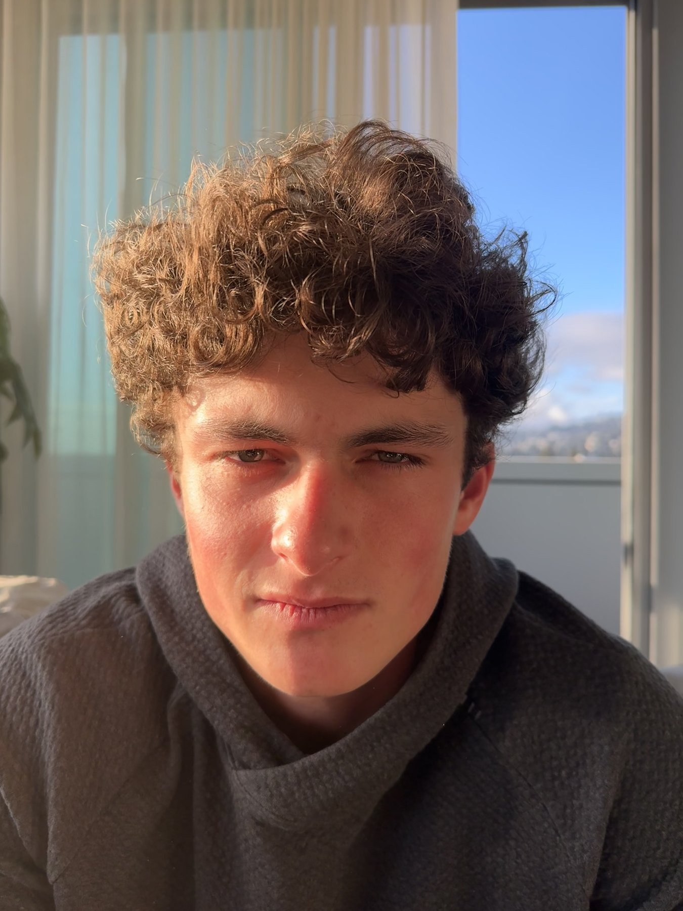 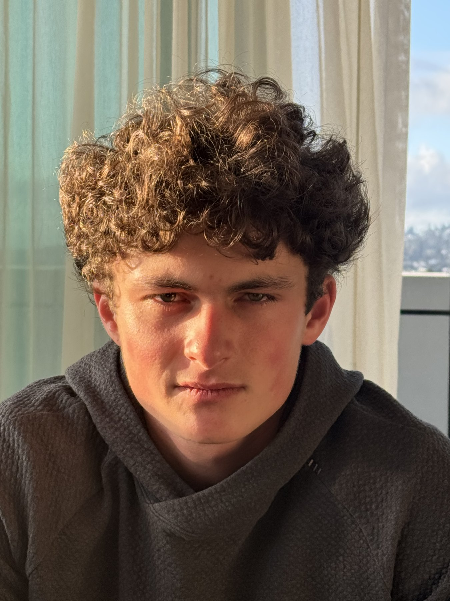

I took these photos of my friend Gaby (mid mew) using an iPhone 15 Pro. EXIF Metadata shows effective focal lengths at 24mm and 83mm.
This first photo is taken with a 24mm lens from a close distance. The second was with an 83mm lens from a further distance.

The idea is simple: a subject of height H projects onto an effective height of fH/D, where f is the focal length and D is the distance to the COP.
So f and D have to scale by the same factor.

The reason why facial features are distorted in the first picture is because closer features get magnified more than further features 

If you imagine a face as a 3D surface the nose is often the feature that sticks out the most, followed by the forehead and chin and cheekbones. Those are the features that obviously get magnified. The ears are a great example of being scaled to be a lot smaller, since they're furthest from the camera.

## The tunnel

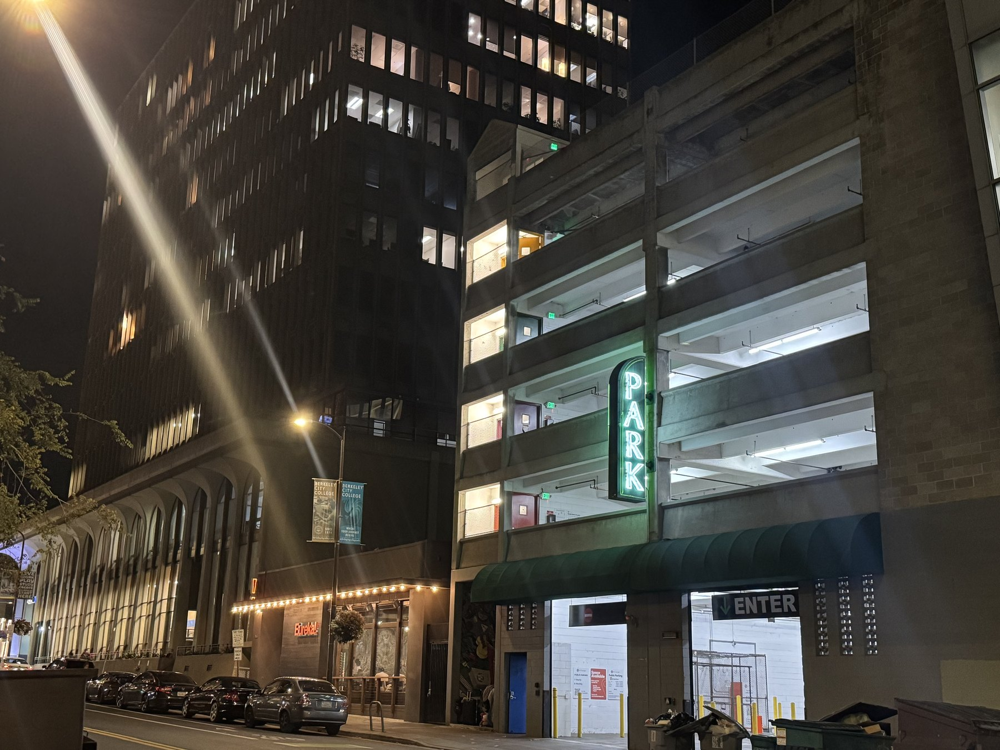 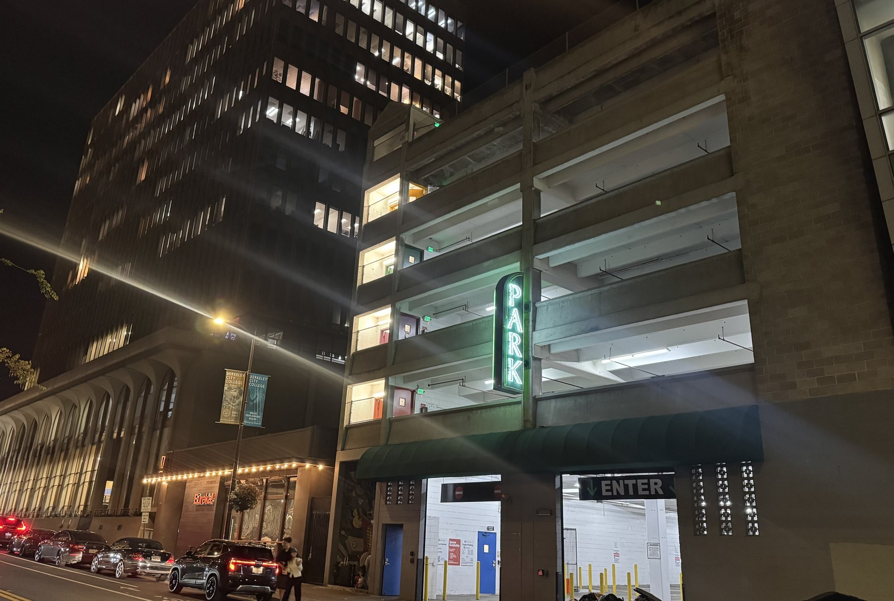

This is meant to show perspective compression. 

When photographing a scene from very far away, objects at different depths look closer together than they are, achieving
the effect of squashing the scene. It's the opposite effect of what we saw above.

The general idea is that the distance D from the object to the COP will scale depths at different ratios.

## The dolly zoom

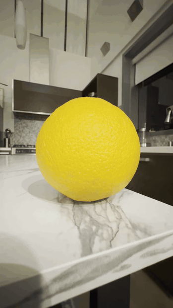 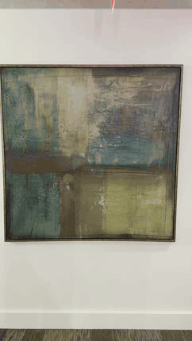 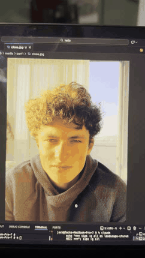

A dolly zoom is moving back while zooming in.

We want the object’s height in the image, fH/D, to stay constant, so we keep f/D constant. As we move back (increase D), we increase f proportionally.

The background doesn’t get the same treatment. It’s farther away, so moving back changes its distance by a smaller fraction, while f is still increasing at the subject’s rate. So the background gets magnified relative to the subject and appears to swell in behind it, and the whole scene flattens out, just like in the architecture shots.

The painting is the exception that proves the rule: it’s flat against the wall, so the painting and the wall scale together, and only the floor and ceiling give the effect away.

GIFs print as a single frame, so the PDF gets the progression as stills:

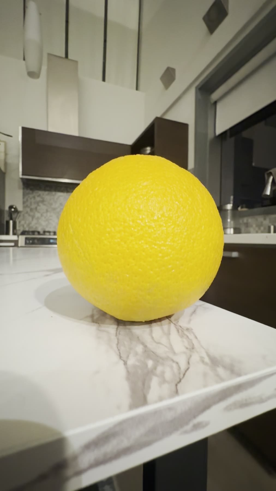 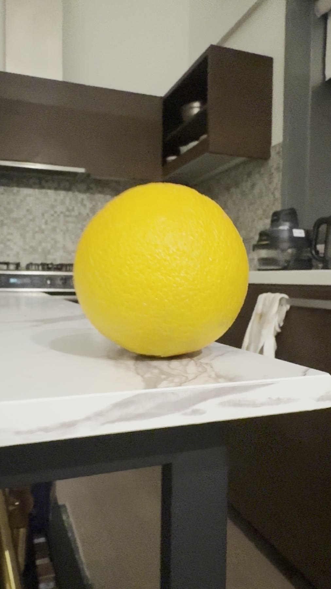 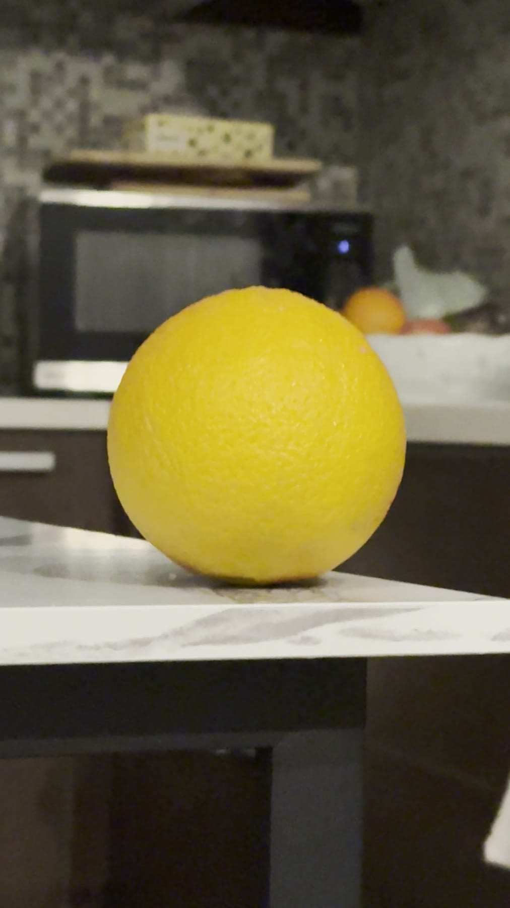 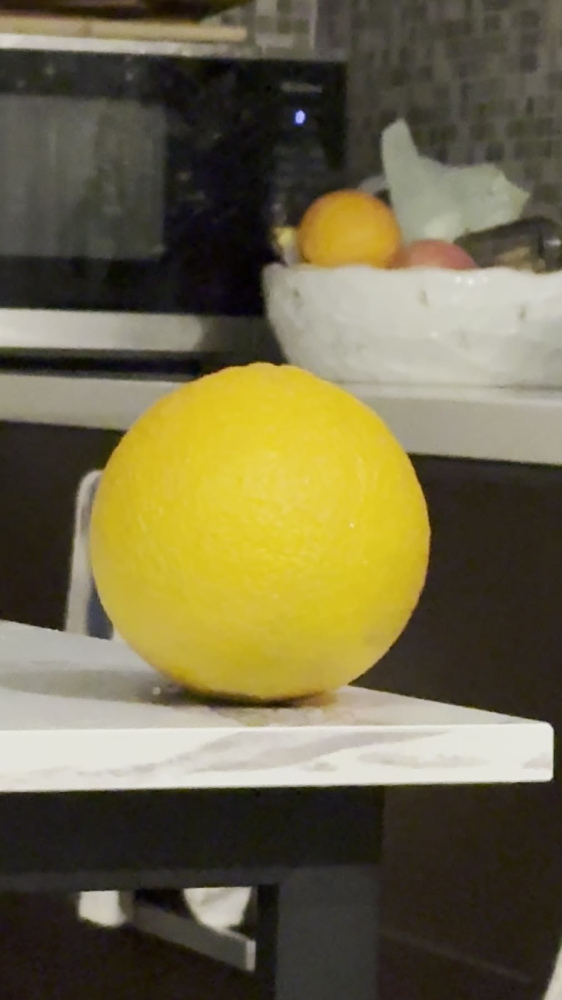

## Sources

- [CS180 Project 0 description](https://cal-cs180.github.io/fa26/hw/proj0/index.html)

## Thanks

Alexei Efros

Ren Ng

Gabriel Rebeiz
