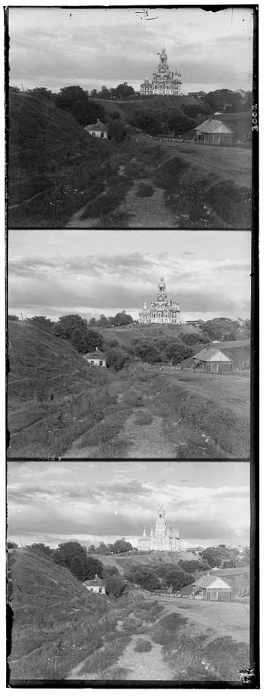
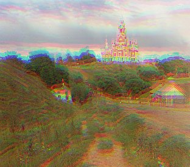
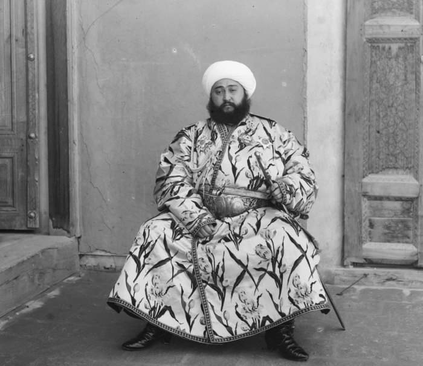
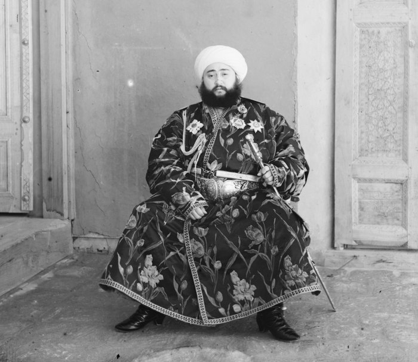
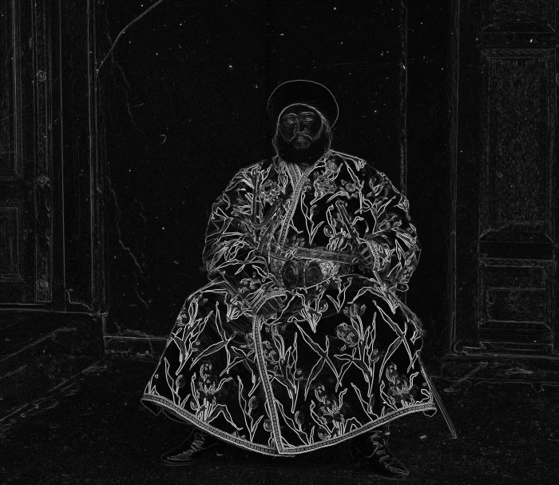
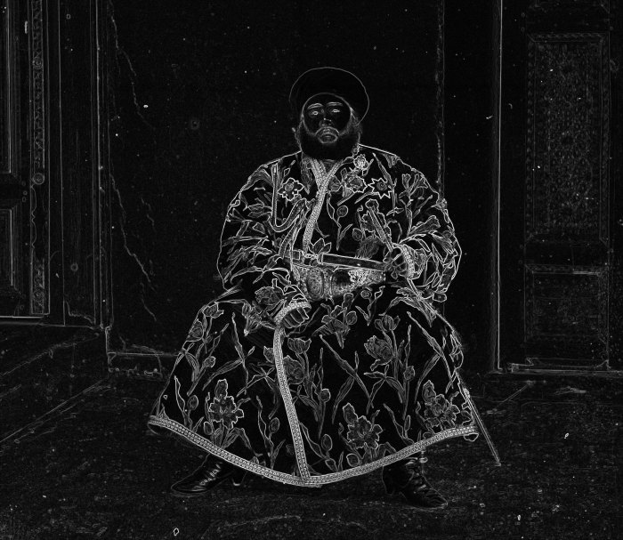

<!-- This file is the whole page. Cheat sheet: ../README-posts.md -->
## The problem

<details><summary>About this project</summary>

> Sergei Mikhailovich Prokudin-Gorskii (1863-1944) [Сергей Михайлович Прокудин-Горский, to his Russian friends] was a man well ahead of his time. Convinced, as early as 1907, that color photography was the wave of the future, he won Tzar's special permission to travel across the vast Russian Empire and take color photographs of everything he saw including the only color portrait of Leo Tolstoy. And he really photographed everything: people, buildings, landscapes, railroads, bridges... thousands of color pictures! His idea was simple: record three exposures of every scene onto a glass plate using a red, a green, and a blue filter. Never mind that there was no way to print color photographs until much later -- he envisioned special projectors to be installed in "multimedia" classrooms all across Russia where the children would be able to learn about their vast country. Alas, his plans never materialized: he left Russia in 1918, right after the revolution, never to return again. Luckily, his RGB glass plate negatives, capturing the last years of the Russian Empire, survived and were purchased in 1948 by the Library of Congress. The LoC has recently digitized the negatives and made them available on-line.
>
> — from the [CS180 Project 1 description](https://cal-cs180.github.io/fa26/hw/proj1/index.html)

</details>

Any one of these scans is a grayscale image stacked into thirds (B -> G -> R).
When you cut an image along thirds and stack them, you get a poorly misaligned colour image. This is because the camera and plate moved slightly between exposures.

The idea is to execute some set of shifts (dy,dx) that puts green and red on blue.

 

## Meta (Why?)

Problem: Image Registration

Formally: Given a reference image $I_r$ and a moving image $I_m$ of the same scene, find:

$$
T^* = \arg\min_{T \in \mathcal{T}} \; \mathcal{L}\big(T(I_m),\, I_r\big)
$$

Here $\mathcal{T}$ is just the set of 2D translations $(dy, dx)$ in a search window (we use [-15,15] for brute force), the blue plate is $I_r$, green and red take turns as $I_m$, and $\mathcal{L} = -\mathrm{NCC}$.

Commercial applications: Multispectral satellite and drone imaging, Multi-frame photography (HDR+ Nightmode etc.), Film restoration, Semiconductor inspection and lithography alignment

Subproblems:

- Defining a proper similarity metric (L2 vs. NCC)

- Computationally tractable search strategies (image pyramid)

- Finding a representation robust to channel differences (Sobel edge filters)


## Single-scale alignment

If a human were given R/G/B cutouts, they might just layer them over each other and fiddle around a bit until the color fringing disappeared. This is the idea of brute-force search.

Formally, we can brute force alignment by searching a window of (dy,dx) in [-15,15], fixing the blue channel trying every possible shift of green and red channels and keep the offset that minimizes some loss.

That yields 31*31 = 961 candidates for a full search. 

### Deriving NCC

We want a loss function that will capture how "overlapping" any two plates are. Since any two images $a$ and $b$ are just high-dimensional vectors, we can use the dot product to measure their similarity:

$$
\sum_i a_i b_i
$$

This function is large when bright pixels line up with bright pixels and dark pixels line up with dark pixels. 

This is a crude initial approximation of similarity, because when two images are mostly bright, the dot product is large, even if the underlying structures in the image don't agree. So we want to normalize for brightness. To do this, we subtract the mean.

**Fix 1:**

$$
\sum_i (a_i - \bar a)(b_i - \bar b)
$$

Now a pixel is positive if it's brighter than average and negative if it's darker. When both agree, the product is positive, and when they disagree, it's negative. Random overlap cancels out.

The problem now is contrast. A high-contrast image has bigger deviations from its mean, so it gets a bigger score than a low-contrast one, even if both match perfectly. We want to normalize for contrast too. To do this, we divide by the sizes.

**Fix 2:**

$$
\mathrm{NCC}(a, b) = \frac{\sum_i (a_i - \bar a)(b_i - \bar b)}{\lVert a - \bar a \rVert \, \lVert b - \bar b \rVert}
$$

After normalizing, we get normalized cross-correlation. It's just the cosine of the angle between the two mean-centered images, so it's always between −1 and 1. 1 means the patterns match perfectly, 0 means they're unrelated, and −1 means they're inverted (this comes back to bite us with Emir).

Since we want lower to be better, we minimize −NCC.

### Single-scale alignment: Process

We begin by cropping borders. Plate edges have black frames, scratches and scanner noise that are channel-invariant, so we cut 10% off each side of every channel before aligning.

 · R (12, 3)")  · R (3, 2)")  · R (6, 3)")

Offsets are (dy,dx) in pixels relative to blue. This is plain NCC on raw pixel values, and each image takes about 0.3s.

Small aside about computational feasibility. 

We're looking at a (31x31) window for smaller (about 390x340px) pictures since the largest known shift on any one of these .jpgs is 12px (cathedral red). Computing one NCC score takes around 312x273 = 85,000 multiply-adds, so aligning 2 channels x 961 shifts x 85,000 pixels yields 1.6e8 operations, which numpy can get done in about 0.3 seconds. 

If we scale the image up, we have to scale the window up too. For example a cropped .tif channel is about 3000x2550 = 7.6 million pixels, which is 90x more than a .jpg, so our window has to be [-180,180] = 130,000 shifts. The same cost function is about 2 x 10^12 operations, which is hours of computation instead of a fraction of a second. This motivates the pyramid below.

## Multi-scale pyramid alignment

A priori, brute forcing a .tif scan would take hours. 

Instead we use the property that the shift scales with resolution. i.e. if red is off by 177px at true resolution, at level 1 it's off by at most 88.5px, and by level 4 it's at most 11px. If this is true then we can get the right answer to within an integer at the bottom level with [-15,15] search, and when we upsample at every level the error will be within +-1px, so we do a [-2,2] search to reset the error.

```
Algorithm 1: PyramidAlign(M, B)
Input:  moving channel M, reference channel B (blue)
Output: integer offset (dy, dx) that aligns M to B

 1:  M₀ ← M,  B₀ ← B,  L ← 0
 2:  while min(size(M_L)) > 200 do                ▷ build the pyramid
 3:      M_{L+1} ← Downsample(M_L, 1/2)
 4:      B_{L+1} ← Downsample(B_L, 1/2)
 5:      L ← L + 1
 6:  end while
 7:  (dy, dx) ← Search(M_L, B_L, (0, 0), 15)      ▷ coarse: wide search
 8:  for k ← L − 1 downto 0 do                    ▷ coarse-to-fine
 9:      (dy, dx) ← Search(M_k, B_k, (2·dy, 2·dx), 2)
10:  end for
11:  return (dy, dx)
```

```
Subroutine: Search(M, B, (c_y, c_x), r)
 1:  return  argmax       NCC( Shift(M, dy, dx), B )
            dy ∈ [c_y − r, c_y + r]
            dx ∈ [c_x − r, c_x + r]
```

Source code is below.


```python
# recursive image pyramid
def align(moving, ref, min_size=200):
    if min(moving.shape) <= min_size:
        return search(moving, ref, (0, 0), 15)      # coarse: wide search
    small_m = cv.resize(moving, None, fx=0.5, fy=0.5, interpolation=cv.INTER_AREA)
    small_r = cv.resize(ref,    None, fx=0.5, fy=0.5, interpolation=cv.INTER_AREA)
    dy, dx = align(small_m, small_r, min_size)
    return search(moving, ref, (2 * dy, 2 * dx), 2) # fine: ±2 refine
```

Each full resolution .tif aligns in about 0.7s for both channels. The `search` here scores Sobel edge maps instead of raw pixels, which is explained in the bells & whistles section.

 · R (12, 3)")  · R (58, −4)")  · R (107, 40)")

 · R (124, 14)")  · R (90, 23)")  · R (177, 13)")

 · R (3, 2)")  · R (176, 37)")  · R (96, −24)")

 · R (111, 9)")  · R (6, 3)")

| Image | Channel size | Green (dy, dx) | Red (dy, dx) | Time |
|---|---|---|---|---|
| cathedral | 390 × 341 | (5, 2) | (12, 3) | 0.2 s |
| church | 3634 × 3202 | (25, 4) | (58, −4) | 0.7 s |
| emir | 3702 × 3209 | (49, 24) | (107, 40) | 0.7 s |
| harvesters | 3683 × 3218 | (60, 17) | (124, 14) | 0.7 s |
| icon | 3741 × 3244 | (42, 17) | (90, 23) | 0.8 s |
| ilemselga | 3800 × 3270 | (40, 7) | (131, 11) | 0.7 s |
| melons | 3770 × 3241 | (80, 10) | (177, 13) | 0.7 s |
| monastery | 391 × 341 | (−3, 2) | (3, 2) | 0.2 s |
| religous_painting | 3742 × 3193 | (30, 4) | (70, 6) | 0.7 s |
| self_portrait | 3810 × 3251 | (78, 29) | (176, 37) | 0.7 s |
| siren | 3817 × 3250 | (49, −6) | (96, −24) | 0.7 s |
| three_generations | 3714 × 3209 | (54, 12) | (111, 9) | 0.7 s |
| tobolsk | 396 × 341 | (3, 3) | (6, 3) | 0.2 s |
| wharf | 3761 × 3244 | (15, −7) | (83, −16) | 0.7 s |

## Three more from the collection

I downloaded three more plates from the [Prokudin-Gorskii collection](https://www.loc.gov/collections/prokudin-gorskii/) and ran the same pipeline on them without changing anything.

 · R (131, 11)")  · R (70, 6)")  · R (83, −16)")

## Failures

When we use NCC on raw pixel values, emir.tif clearly fails. Green came out right at (49,24), but red landed at (78,46) instead of the correct (107,40), which is almost 30 rows off and leaves a red ghost over the whole portrait.

The emir's robe is bright blue, so it will show up as white on the blue plate and nearly black on the red plate. Raw-pixel NCC assumes that any two channels have correlated intensities, but here the biggest high contrast object in the frame (the robe) is closer to anti-correlated between B and R, so the score will peak at the wrong shift.

 

We fix this using edge based matching with Sobel Filters below. With this method, all 14 images align, including Emir. The limit is that it only finds one global (dy,dx) per channel, so it can't fix rotation, lens distortion or a warped plate. We explore what such a representation might entail at the end of this blog. 

## Bells & whistles

### Edge based alignment

Brightness differs between channels (for example with the blue and red channels and the emir's robe above), but edges show up in the same place in all three. In plain English, the outline of the robe is there whether the robe is light or dark. 

As a heuristic, we would like some method that can correlate the dark on white edge in the red plate with the same edge that ends up being white on dark in the blue plate. Mathematically we can express this as a gradient magnitude edge filter, which throws away the sign. We derive this below:

**Start: an edge is where brightness changes quickly.**

We can capture this notion of change with a derivative. On a pixel grid, we approximate it with a central difference:

$$
\frac{\partial I}{\partial x} \approx \frac{I(x+1, y) - I(x-1, y)}{2}
$$

This is the same thing as convolving each row with the kernel $\begin{pmatrix} -1 & 0 & 1 \end{pmatrix}$ (dropping the constant ½, which NCC normalizes away anyway).

This is positive when brightness goes dark to light and negative when it goes light to dark. That sign is our original problem in disguise: the robe's edge is positive in one plate and negative in the other.

**Fix 1: derivatives amplify noise.**

A single-pixel difference reacts just as strongly to film grain and scratches as to real edges. So we average the derivative across the neighbouring rows, weighting the centre row most:

$$
G_x = \begin{pmatrix} 1 \\ 2 \\ 1 \end{pmatrix} \begin{pmatrix} -1 & 0 & 1 \end{pmatrix} = \begin{pmatrix} -1 & 0 & 1 \\ -2 & 0 & 2 \\ -1 & 0 & 1 \end{pmatrix}, \qquad G_y = G_x^\top
$$

This is the Sobel kernel. It differentiates in one direction and smooths in the other. $G_y$ does the same for horizontal edges.

**Fix 2: edges point in every direction, and we don't care about the sign.**

$G_x * I$ and $G_y * I$ together form the gradient vector at each pixel. We keep only its length:

$$
E = \sqrt{(G_x * I)^2 + (G_y * I)^2}
$$

This is where the robe gets fixed. Suppose that around the robe the red plate is roughly an inverted, rescaled copy of the blue one, $I_R \approx a - k\, I_B$ with $k > 0$. Then the gradients flip sign:

$$
\nabla I_R \approx -k\, \nabla I_B \quad \Longrightarrow \quad E_R \approx k\, E_B
$$

Taking the magnitude removes the minus sign, and the leftover scale factor $k$ is exactly the kind of contrast difference NCC already normalizes away. The same argument works for regions where the channels are positively correlated ($I_R \approx a + k\, I_B$). So regardless of whether the robe is light or dark in a given plate, its outline produces the same edge map.

We then score alignment on the edge maps:

$$
\text{score} = \mathrm{NCC}(E_{\text{moving}}, E_{\text{blue}})
$$

 

<div class="compare" data-left="media/bells/emir_raw.jpg" data-right="media/pyramid/emir.jpg" data-left-label="raw pixels" data-right-label="edges" data-caption="drag · raw-pixel NCC: G (49, 24), R (78, 46) → edge NCC: G (49, 24), R (107, 40)"></div>

These two methods agree to within 1 to 3 px on the other 13 images.

For example religous_painting G (27,3) -> (30,4) and three_generations G (53,14) -> (54,12). Emir is the only one where the difference is very obvious.

### Trimming the wrapped border

Sometimes I observed that the untrimmed version had a band wrapping around the edge of the plate. This is because `np.roll` keeps the image the same size by wrapping, so after shifting red by 177 rows the bottom 177 rows of red end up pasted across the top of the picture. 

The fix is trivial: after aligning, we crop every row and column that any channel wrapped.

<div class="compare" data-left="media/bells/melons_untrimmed.jpg" data-right="media/pyramid/melons.jpg" data-left-label="untrimmed" data-right-label="trimmed" data-caption="drag · look at the top edge: the untrimmed version has a band of red and green wrapped around from the bottom of the plate"></div>

This is also why the images in the gallery have slightly different aspect ratios, since each one loses the strip its shifts wrapped.

## Beyond Bells & Whistles: The Modern Research Frontier

In my opinion, this project is pretty close to a best-case scenario for image registration. A few observations: 
- **A: Rigid, nearly static camera.** Between exposures the camera and plate only shifted slightly within the image plane, with no rotation, zoom or tilt. So $T$ is just $(x + dx,\, y + dy)$: a global warp with 2 degrees of freedom, small enough to brute-force.
- **B: Linear, monotonic colour relationships.** The scene is captured with pretty much the same physical light with different filters. This means that pixel intensities are linearly correlated between R,G,B plates, which is the assumption undergirding NCC loss, and which our use of Sobel filters extends to the anticorrelated case.
- **C: The actual scenes being captured don't change.** If there was dynamic motion (objects in scene move), object occlusion (foreground elements blocking background elements between exposures), or parallax shift (camera translation relative to scene depth), then we can not define a single global warp to do this. In this case, every pixel would need its own displacement, and occluded pixels would have no match at all.

This sparked my curiosity because I started imagining the hardest problems that could be solved if these assumptions were relaxed. This leads to the natural question of at what point does this problem become something harder than Image Registration? 

Imagine a dynamic camera with 6DoF (x,y,z,pitch, yaw, roll) and a non-static scene with moving objects, realistically any sufficient movement of our camera along any one of those degrees of freedom or any sufficient movement of the scene can make it so none of the pixels correspond anymore (i.e. if you take a picture of a person then move the camera such that they're out of frame and take a second photo, there is no longer any "alignment" to be done). 

This is the point at which the problem of image registration (in which we try to transform or align two images of the same scene) leads us to a new class of problems in which images come from different but related scenes. I briefly list examples of such problems below, and links to groups or labs that are tackling these issues.

| Name | Explanation | Groups Working on It |
|---|---|---|
| **3D reconstruction** | Take overlapping photos of a place from different angles, rebuild the 3D scene, plus where each photo was taken from. | [Niantic Spatial (Scaniverse)](https://nianticspatial.com/), [Polycam](https://poly.cam/) |
| **Visual positioning / place recognition** | Figure out exactly where a camera is, and which way it's facing, just from what it sees | [Niantic Spatial VPS](https://nianticspatial.com/products/localize), [Google ARCore Geospatial API](https://developers.google.com/ar/develop/geospatial) |
| **Change detection** | Compare before/after images of the same area (often from satellites) and find what changed: new buildings, flood damage, moved vehicles. | [Vantor (formerly Maxar)](https://vantor.com/), [Planet](https://www.planet.com/) |
| **Semantic correspondence** | Match parts of *different* objects of the same kind, like the eye of one cat to the eye of another. Nothing aligns pixel-for-pixel, so matching relies on learned features. | [Meta AI (DINOv2)](https://ai.meta.com/blog/dino-v2-computer-vision-self-supervised-learning/) |
| **Novel view synthesis / world generation** | Generate what a scene looks like from viewpoints no camera captured, filling in content that isn't in any input image. | [World Labs (Marble)](https://www.worldlabs.ai/) |

Confined to the problem of image registration (where there still exists a coordinate mapping between pixels in two or more images), I note some thoughts below on how we can break our assumptions above.

We can break **A** by imagining a set of problems where the transformation is not global. For example, in medical imaging, lungs may inflate in a way where the top of the lung moves one way and the bottom of the lung moves another. In this way we can no longer learn a global $\mathcal{T}$ but rather have to learn a displacement field $u(x, y)$, with one vector per pixel.
Since you now have millions of unknowns instead of 2, we choose to optimize this field with gradient descent with a smoothness penalty so the warp does not fold or tear any tissue.

Classic methods include Large Deformation Diffeomorphic Metric Mapping (LDDMM), which is an algorithm that models the deformation between two anatomical objects as a smooth, invertible flow that preserves topology and prevents tearing or folding. [ResNet-LDDMM](https://arxiv.org/abs/2102.07951) is a recent version that learns this flow with a deep residual network.

We can break **B** by imagining a set of problems where the images come from different sensors. For example, in satellite imaging, we might want to align a regular photograph with a thermal (infrared) or radar scan of the same area. A hot road might look bright white on thermal but dark grey in the photograph, while a cold river might look dark in both. As mentioned before, the relationship between pixel intensities is no longer linear, or even monotonic, so neither NCC nor our Sobel trick can score a match.
Instead of asking whether pixel values are similar, we can ask whether one image's values are predictable from the other's. This is measured by [mutual information](https://doi.org/10.1023/A:1007958904918), $I(A; B) = \sum p(a,b) \log \frac{p(a,b)}{p(a)p(b)}$, which is high whenever knowing a pixel in $A$ tells you a lot about the matching pixel in $B$, whatever the actual relationship is.

[More recent methods](https://arxiv.org/abs/2601.08875) learn to separate an image's underlying scene structure from its sensor-specific appearance and only then align on structure.

We can break **C** by imagining a set of problems where the scene itself changes between frames. This is a subproblem of A but large enough to merit its own treatment. For example, in video from a moving car, the background shifts as the camera moves while pedestrians and other cars move on their own paths, and they block different parts of the background in each frame. Every pixel needs its own displacement, and pixels that become hidden have no match at all.
Here we estimate optical flow, a dense displacement field between consecutive frames, much like the one for **A**. But instead of only enforcing smoothness, we must also handle motion boundaries and occluded regions where no correspondence exists.

Modern methods such as [RAFT](https://arxiv.org/abs/2003.12039) learn flow end-to-end by comparing features between every pair of pixels in the two frames and refining the flow field iteratively.

## Sources

- [CS180 Project 1 description](https://cal-cs180.github.io/fa26/hw/proj1/index.html)
- [Prokudin-Gorskii Collection](https://www.loc.gov/collections/prokudin-gorskii/), Library of Congress
- Viola and Wells, [Alignment by Maximization of Mutual Information](https://doi.org/10.1023/A:1007958904918), IJCV 1997
- Ben Amor, Arguillère and Shao, [ResNet-LDDMM: Advancing the LDDMM Framework using Deep Residual Networks](https://arxiv.org/abs/2102.07951)
- Qin and Wang, [Learning Domain-Invariant Representations for Cross-Domain Image Registration via Scene-Appearance Disentanglement](https://arxiv.org/abs/2601.08875)
- Teed and Deng, [RAFT: Recurrent All-Pairs Field Transforms for Optical Flow](https://arxiv.org/abs/2003.12039), ECCV 2020

## Thanks

Alexei Efros

Ren Ng

Andrei Cojocaru

Jack Pryor

