<!-- This file is the whole page. Cheat sheet: ../README-posts.md -->

In this post, I'll build convolution from scratch, use it to find edges, and then split images into frequencies to sharpen them, make hybrid images and blend them. The one-line summary is: almost everything here is the same two filters. A Gaussian $G$ keeps the low frequencies, and the impulse minus a Gaussian, $e - G$, keeps the high ones.

$$
I = \underbrace{I * G}_{\text{low}} + \underbrace{I * (e - G)}_{\text{high}}
$$

Edge detection, sharpening, hybrids and blending are all just different ways of splitting an image into these two bands and adding them back with different weights.

<details><summary>About this project</summary>

This is the second project of [CS180 (Computer Vision)](https://cal-cs180.github.io/fa26/hw/proj2/index.html) with Alexei Efros and Ren Ng.

Definitions:
A filter (or kernel) is a small grid of weights. Convolving an image with a filter replaces every pixel with a weighted sum of its neighbours.
The low frequencies of an image are the slow changes: overall shapes and colours. The high frequencies are the fast changes: edges, texture and noise.

</details>

## Part 1: Filters

### 1.1 Convolution from scratch

A convolution slides a flipped kernel over the image and, at every pixel, sums the kernel times the patch under it. I wrote it twice in numpy: once with four loops, and once with two loops where the inner window becomes a single multiply-and-sum. Both zero pad so the output is the same size as the input, matching `scipy.signal.convolve2d(..., mode='same')`.

<details><summary>Code</summary>

```python
# four loops
def convolve_four_loops(img, kernel):
    kh, kw = kernel.shape
    img = np.pad(img, ((kh//2, kh//2), (kw//2, kw//2)))   # zero fill, "same" size
    x, y = img.shape
    out = np.zeros((x-kh+1, y-kw+1))
    kernel = np.flip(kernel)                               # flip both axes
    for i in range(x-kh+1):
        for j in range(y-kw+1):
            total = 0
            for u in range(kh):
                for v in range(kw):
                    total += img[i+u][j+v] * kernel[u][v]
            out[i][j] = total
    return out

# two loops: the inner window becomes one numpy multiply + sum
def convolve(img, kernel):
    kh, kw = kernel.shape
    img = np.pad(img, ((kh//2, kh//2), (kw//2, kw//2)))
    x, y = img.shape
    out = np.zeros((x-kh+1, y-kw+1))
    kernel = np.flip(kernel)
    for i in range(x-kh+1):
        for j in range(y-kw+1):
            patch = img[i:i+kh, j:j+kw]
            out[i][j] = (patch * kernel).sum()
    return out

Dx  = np.array([[1, 0, -1]])
Dy  = Dx.T
Box = np.ones((9, 9)) / 81      # 9x9 box that sums to 1
```

</details>

Here's the result for a 9 × 9 box filter on the 542 × 540 cameraman:

| Method | Time | ‖mine − scipy‖ |
|---|---|---|
| Four loops | 8.00 s | 1.6e−13 |
| Two loops | 0.49 s | 6.1e−14 |
| scipy convolve2d | 0.04 s | n/a |

All three produce the same image up to floating point. Four loops is 16x slower than two, because every multiply goes through the Python interpreter, and scipy is another 12x faster because it's compiled. (Even two loops takes 3.6 s on my 1514 × 1144 selfie, which is why the timing uses the cameraman.)

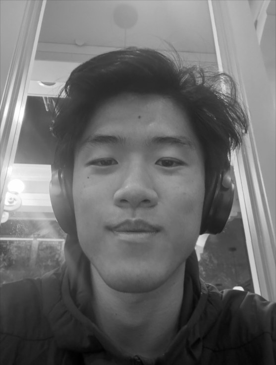 : lights up vertical edges, like the door frame and the sides of my face") : lights up horizontal edges, like the headphone band and my eyebrows")

<div class="compare" data-left="media/part1/selfie_convolved_with_9x9_box_my_convolve.jpg" data-right="media/part1/selfie_convolved_with_9x9_box_scipy_convolve2d.jpg" data-left-label="mine" data-right-label="scipy" data-caption="9x9 box, mine vs. scipy (drag). No visible seam, since they're the same image. Both darken slightly at the very edge because the zero padding gets averaged in."></div>

<details><summary>Why flip the kernel?</summary>

Without the flip, sliding and summing is cross correlation. Convolution indexes the image backwards instead:

$$
(I \otimes K)[i, j] = \sum_{u,v} K[u, v]\, I[i + u,\, j + v], \qquad (I * K)[i, j] = \sum_{u,v} K[u, v]\, I[i - u,\, j - v]
$$

The easiest way to see the difference is to filter a single bright pixel: convolution hands back the kernel exactly, while correlation hands it back upside down. Because of this, convolution behaves like multiplication. It's commutative, $A * B = B * A$, and associative, $(I * A) * B = I * (A * B)$. Correlation is neither. Associativity is what lets us fold two filters into one in 1.3.

</details>

### 1.2 Finite differences find edges, and noise

Convolving with `Dx = [1, 0, −1]` and `Dy = Dxᵀ` gives the partial derivatives, and the gradient magnitude says how fast brightness is changing at each pixel:

$$
\lVert \nabla I \rVert = \sqrt{(I * D_x)^2 + (I * D_y)^2}
$$

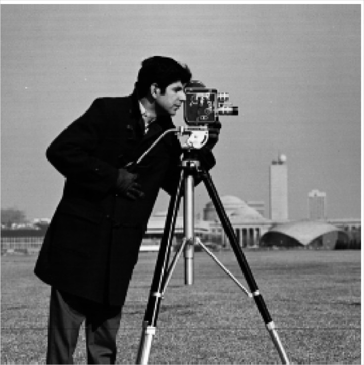 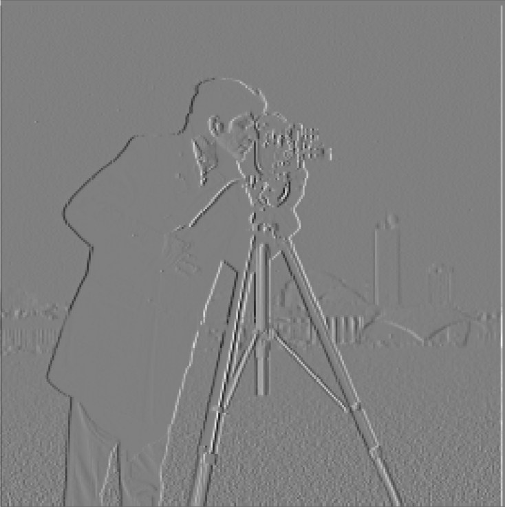 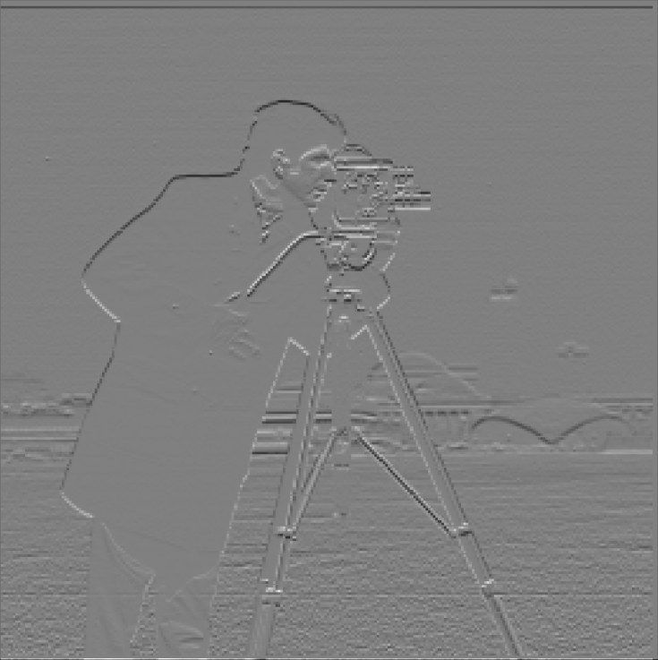 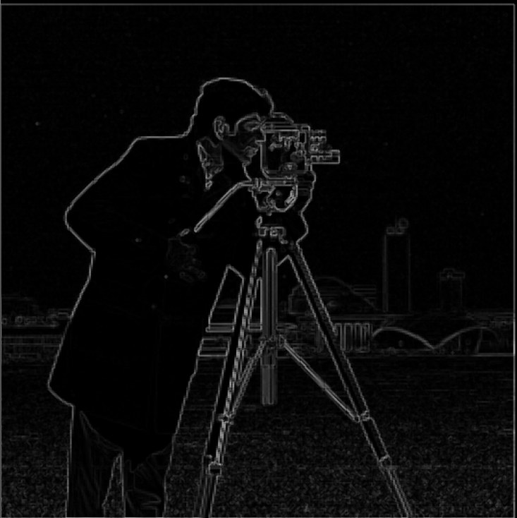

Thresholding the magnitude at **t = 0.17** gives the edge image below.

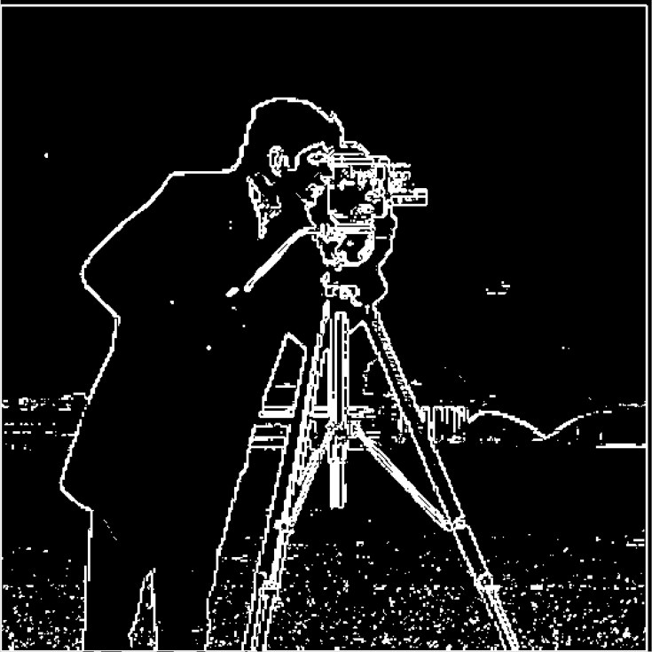

Lower, and the grass turns into white speckle. Higher, and the tripod legs and the background buildings break apart. At 0.17 the cameraman, camera and tripod are fully outlined and most of the grass is gone, at the cost of a little speckle in the bottom left.

The underlying problem is that `Dx` and `Dy` only look at two pixels at a time. A noisy pixel or a single blade of grass looks just like the edge of the cameraman's coat, so no threshold can separate them.

### 1.3 Derivative of Gaussian: blur first, in one filter

The fix is to blur before differentiating. Single-pixel noise gets averaged away, while real edges survive because they're consistent over many pixels. And since convolution is associative, the blur can be folded into the derivative ahead of time:

$$
(I * G) * D_x = I * (G * D_x) = I * \mathrm{DoG}_x
$$

$G$ is a 19 × 19 Gaussian with σ = 3. (The Sobel kernel from Project 1 is the same idea at 3 × 3: a $\begin{pmatrix} 1 & 2 & 1 \end{pmatrix}^\top$ blur times a $\begin{pmatrix} -1 & 0 & 1 \end{pmatrix}$ difference.)

<details><summary>Code</summary>

```python
g = cv2.getGaussianKernel(19, 3)
G = g @ g.T                                  # 19x19 2D Gaussian
blurred = convolve2d(cameraman, G, mode='same')

DoGx = convolve2d(G, Dx)                     # 19x21
DoGy = convolve2d(G, Dy)                     # 21x19
```

</details>

#### Method 1: blur, then differentiate

 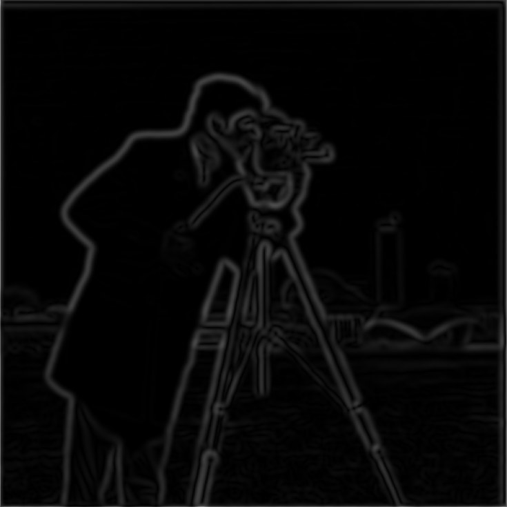 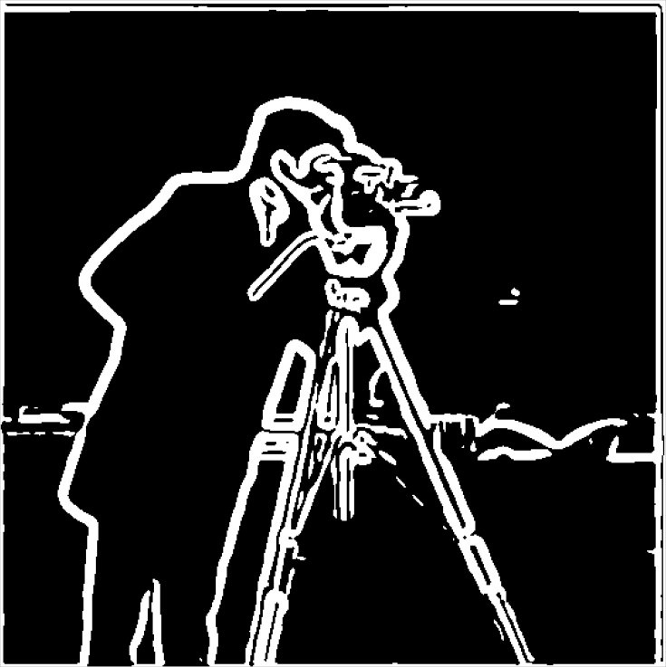

<div class="compare" data-left="media/part1/cameraman_edges_finite_difference_t_0_17.jpg" data-right="media/part1/cameraman_edges_blurred_first_t_0_05.jpg" data-left-label="finite diff" data-right-label="blurred first" data-caption="what changed (drag)"></div>

Compared with plain finite differences:

- The grass speckle is gone.
- Edges are thicker and continuous instead of dashed, since a blurred step is a ramp a few pixels wide.
- Every gradient shrinks (the maximum drops from 1.41 to 0.68), so the threshold has to drop from 0.17 to 0.05.
- The finest detail, like the thin lines on the camera, merges together. That's the cost of the blur.

#### Method 2: one convolution with DoG

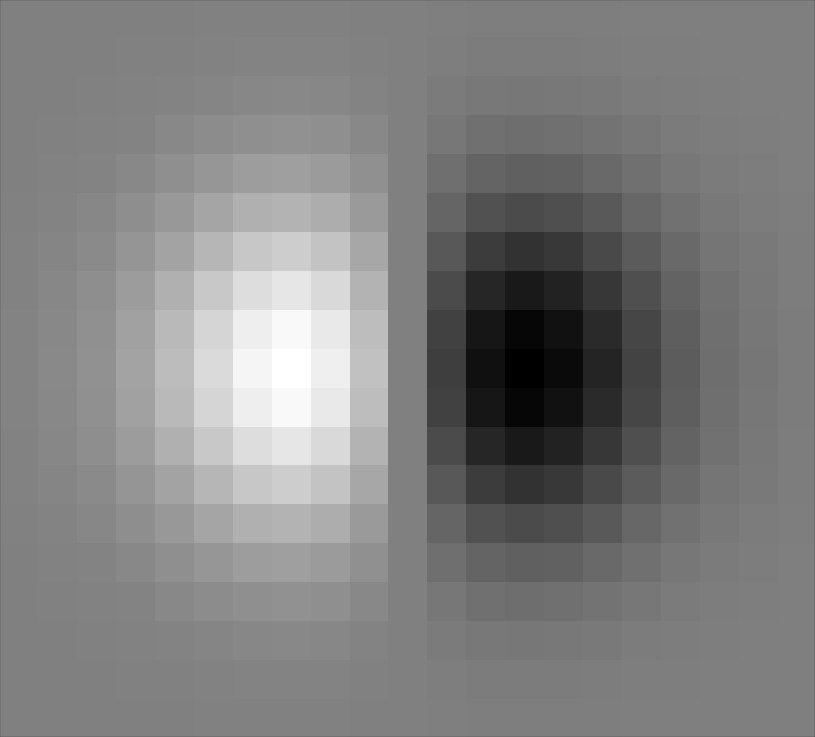 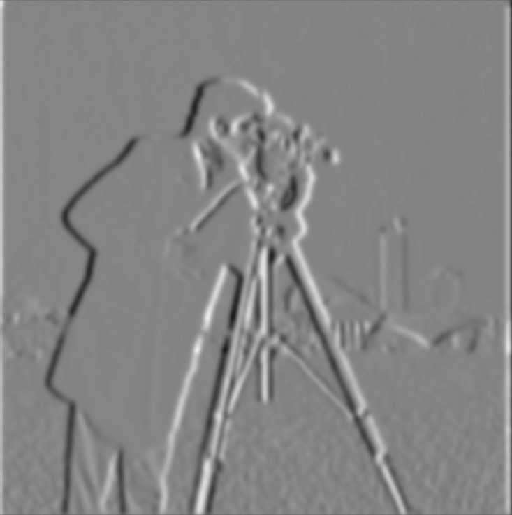 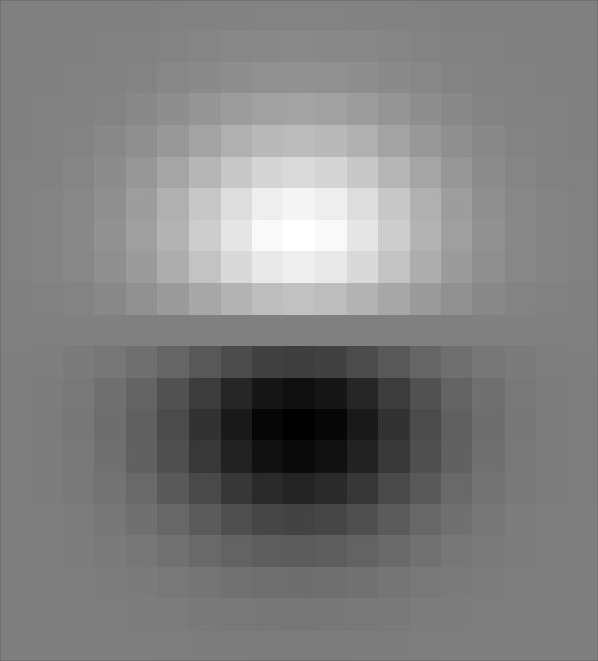 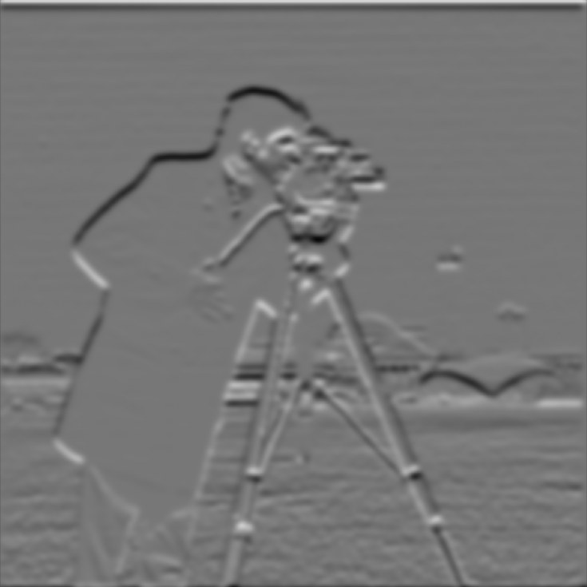

The two methods give the same image. The raw L2 difference is 11.9, but all of it sits on the outermost ring of pixels, where the two versions zero pad different images. Cropping one pixel off each side, the difference is 1.4e−13 in both $x$ and $y$.

<details><summary>Why does the flip matter here?</summary>

The Gaussian is symmetric, so flipping it changes nothing, but `Dx` is antisymmetric: flipping it flips its sign. If I had written correlation instead of convolution, the one-filter version would come out as exactly the negative of the two-step version. The gradient magnitude would look the same, but the two methods would disagree on the sign of every derivative.

</details>

<details><summary>Where is this used?</summary>

The [Canny edge detector](https://doi.org/10.1109/TPAMI.1986.4767851) is DoG plus a few cleanup steps (thinning edges to one pixel and following them along). Corner detectors build on the same $x$ and $y$ derivatives. Some cameras autofocus by moving the lens until the gradient magnitude is largest, since a sharp image has the strongest edges.

</details>

## Part 2: Frequencies

### 2.1 Sharpening boosts what's left

Subtracting a blurred image from the original leaves only the high frequencies. Adding them back with a weight α makes the image look sharper, and the whole operation collapses into a single filter, the unsharp mask:

$$
I + \alpha\,(I - I * G) = I * \big((1 + \alpha)\,e - \alpha G\big)
$$

$e$ is the unit impulse, so $I * e = I$. I apply the filter to each RGB channel, with the same 19 × 19, σ = 3 Gaussian.

<details><summary>Code</summary>

```python
def sharpen(image, a):
    UnsharpMaskFilter = (1 + a) * IdentityKernel - a * GaussianFilter
    r = fftconvolve(image[:,:,0], UnsharpMaskFilter, mode='same')
    g = fftconvolve(image[:,:,1], UnsharpMaskFilter, mode='same')
    b = fftconvolve(image[:,:,2], UnsharpMaskFilter, mode='same')
    return np.stack([r, g, b], axis=2)
```

</details>

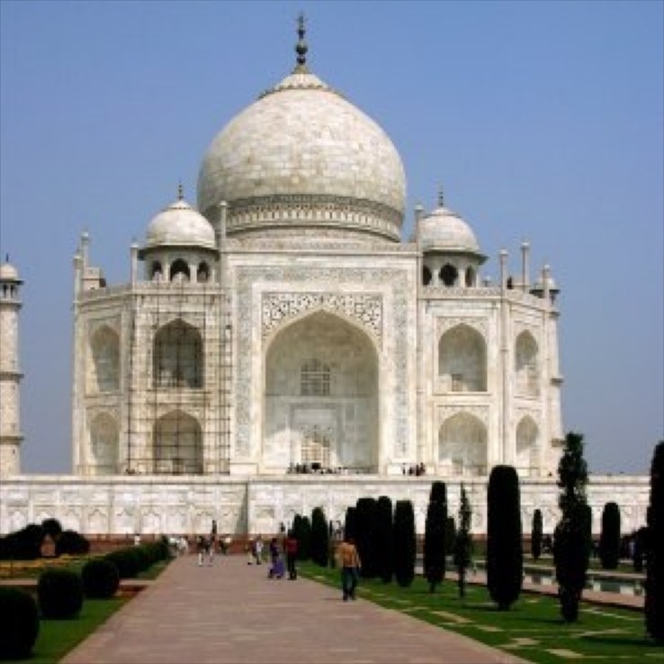 , I * G") 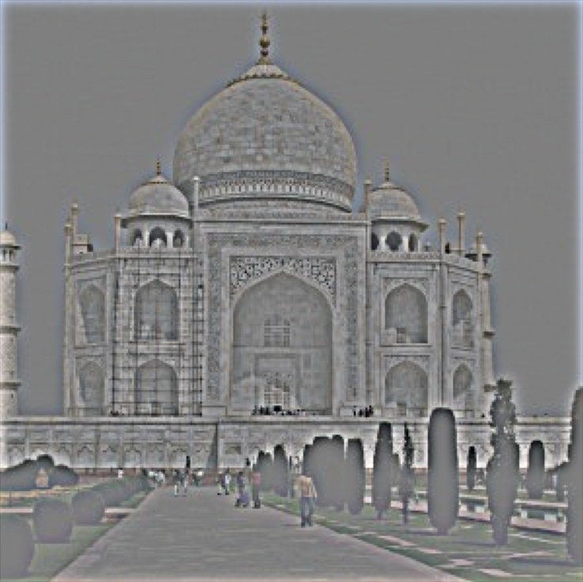 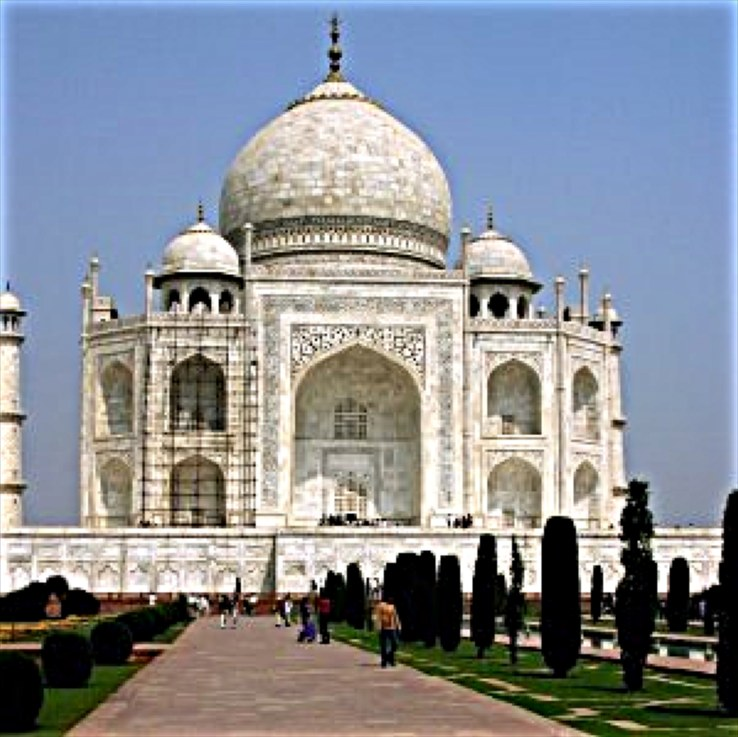

<div class="slider" data-src="media/part2/taj_sharpened_with_alpha_{v}.jpg" data-values="1,2,3,4,5,8,10" data-labels="α = 1,α = 2,α = 3,α = 4,α = 5,α = 8,α = 10" data-caption="Taj sharpened, varying α"></div>

Up to α ≈ 3 it just looks crisper. Past 5, the marble gets dark halos along every edge and the sky starts to show noise, since we're amplifying everything above the cutoff, JPEG artifacts included. At α = 10 it looks like an over-processed HDR photo.

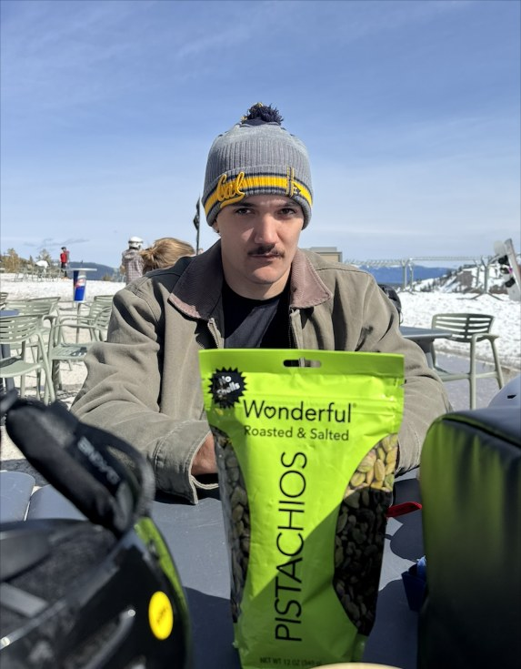 ") 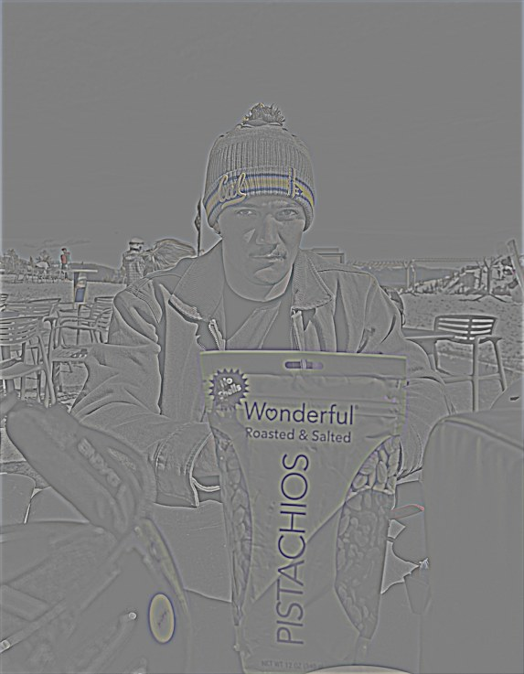 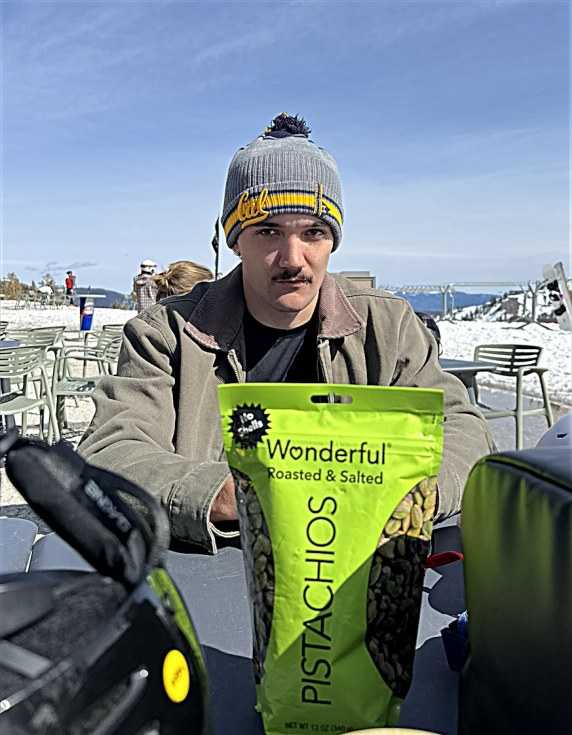

<details><summary>Where does the name come from?</summary>

The film darkroom. Printers would make a blurred ("unsharp") positive copy of a negative and stack it on the original when printing, which cancels out some of the low frequencies. Today it's the "Unsharp Mask" tool in Photoshop and GIMP, and some version of it runs on nearly every photo a phone takes.

</details>

#### Can sharpening undo a blur?

To test this, I blurred each sharp original and then sharpened the blurry copy:

<div class="compare" data-left="media/part2/original_image.jpg" data-right="media/part2/taj_after_blurred_first_and_then_unsharp_filter_applied.jpg" data-left-label="original" data-right-label="blur → sharpen" data-caption="Taj, α = 1"></div>

<div class="compare" data-left="media/part2/golik_original.jpg" data-right="media/part2/golik_after_blurred_first_and_then_unsharp_filter_applied.jpg" data-left-label="original" data-right-label="blur → sharpen" data-caption="Golik, α = 1"></div>

<div class="slider" data-src="media/part2/{set}_first_blurred_and_sharpened_with_alpha_{v}.jpg" data-values="1,2,3,4,5,8,10" data-labels="α = 1,α = 2,α = 3,α = 4,α = 5,α = 8,α = 10" data-sets="Taj=taj|Golik=golik" data-caption="blurred, then sharpened with varying α"></div>

It can't. At α = 1 the dome outline gets a bit crisper, but the carvings in the marble and the letters on the pistachio bag don't come back. Pushing α higher only adds halos around the edges that survived.

<details><summary>Why?</summary>

In the frequency domain, blurring multiplies each frequency $f$ by the Gaussian's response:

$$
\hat{I}_{\text{blurred}}(f) = \hat{I}(f)\, e^{-2\pi^2 \sigma^2 f^2}
$$

At σ = 3 and $f$ = 0.25 cycles/px (detail about 4 pixels wide), that factor is about $e^{-11} \approx 0.00002$. The unsharp mask multiplies each frequency by at most $1 + \alpha$, so even α = 10 only brings that detail back to 0.0002 of its original strength. Scaling up nearly zero still gives nearly zero.

</details>

### 2.2 Hybrid images change with distance

[Oliva, Torralba and Schyns](https://doi.org/10.1145/1141911.1141919) observed that up close, high frequencies dominate what we see, but from far away only the low frequencies survive. So if we add the low frequencies of one image to the high frequencies of another, the picture changes with viewing distance:

$$
H = I_1 * G_1 + I_2 * (e - G_2)
$$

$G_1$ and $G_2$ are Gaussians of size `6σ + 1`. A Gaussian's frequency response, $\exp(-2\pi^2\sigma^2 f^2)$, drops to one half at

$$
f_c = \frac{\sqrt{\ln 2 / 2\pi^2}}{\sigma} \approx \frac{0.187}{\sigma} \ \text{cycles per pixel}
$$

which is how I'll describe the cutoffs below.

<details><summary>Why does distance act like a low pass filter?</summary>

When you step back, the image takes up a smaller angle in your view, so every stripe and edge gets packed into a smaller angle too, and its frequency in cycles per degree goes up. Our eyes can only resolve detail up to a limit (fine stripes above roughly 30 to 60 cycles per degree just look grey), so the high frequencies get pushed past that limit and disappear, leaving only the low ones.

The paper's broader point is that we don't take in all frequencies equally. Depending on distance and on how long we look, we latch onto either the coarse shape or the fine detail, and a hybrid image makes that choice visible.

</details>

#### My favorite: Nutmeg × Golik

I clicked both eyes in each photo to rotate and scale Nutmeg onto Golik, then high passed Nutmeg and low passed Golik:

") ") 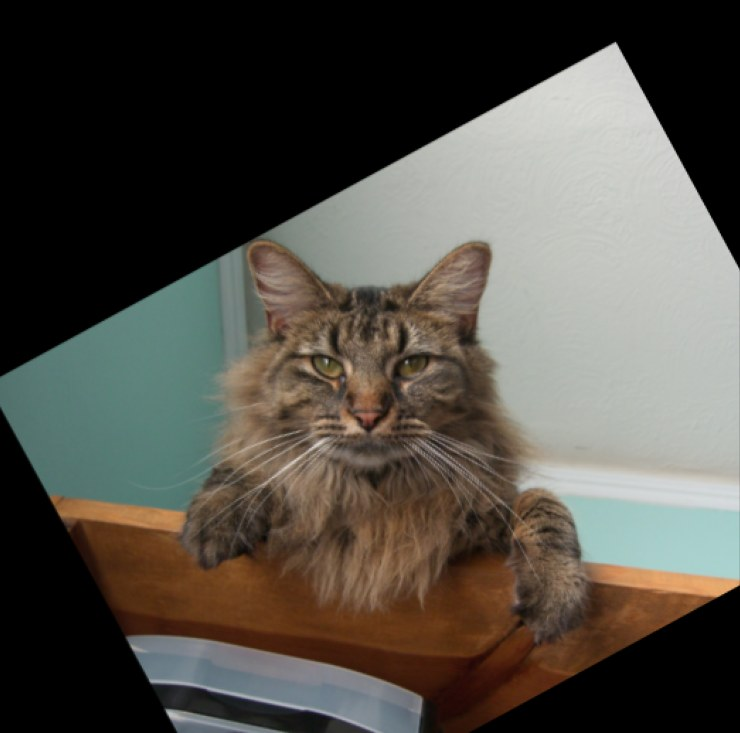 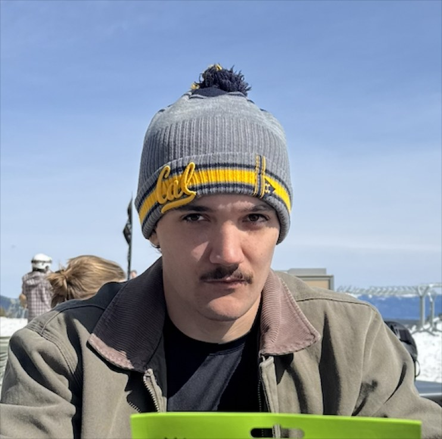

, σ₂ = 4, +0.5 for display: whiskers, fur and eye outlines") 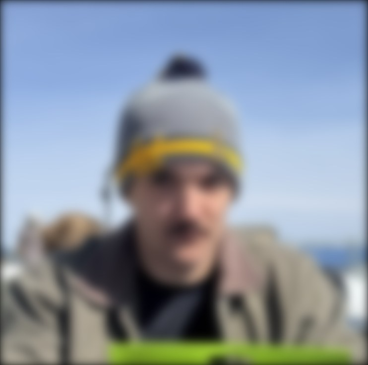 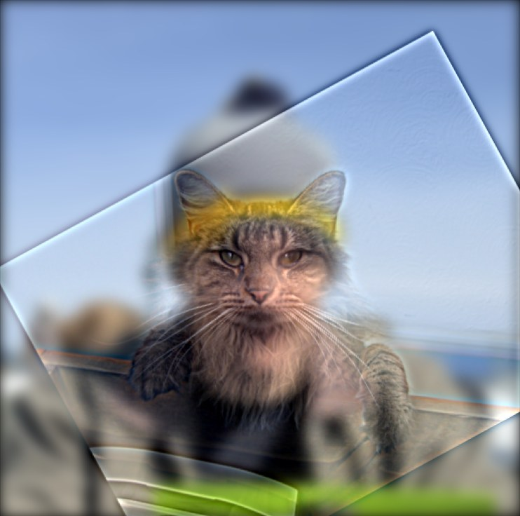

Here are the log-magnitude FFTs (in grayscale, with zero frequency at the center):

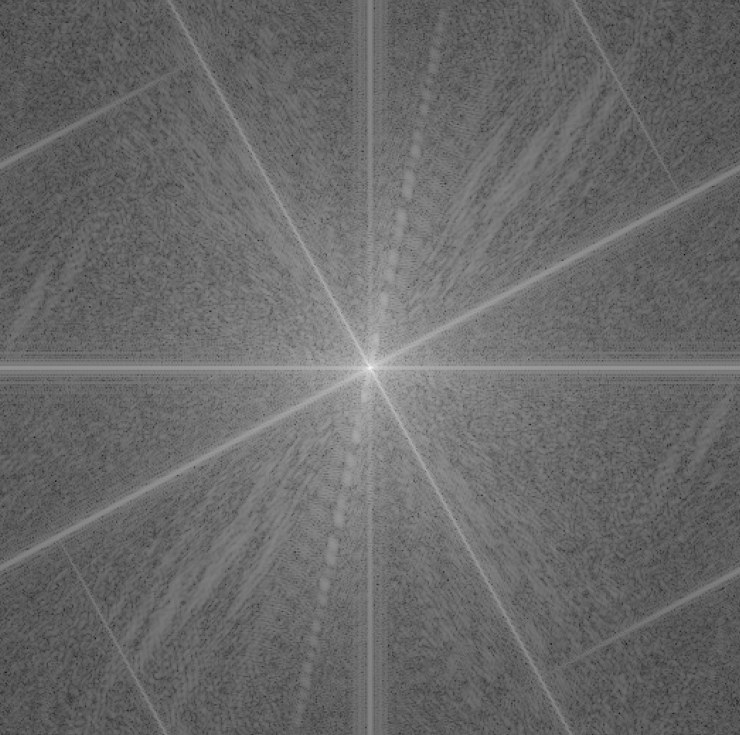 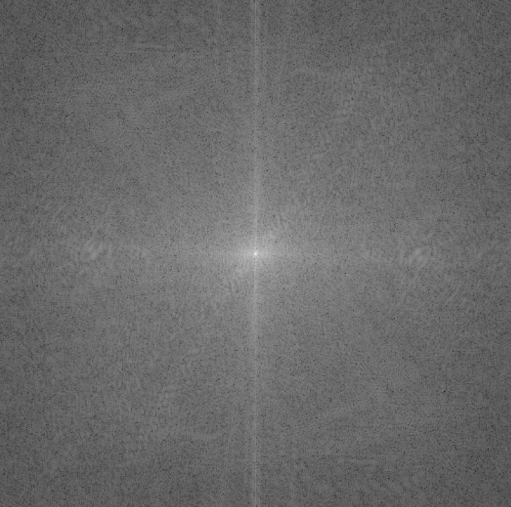 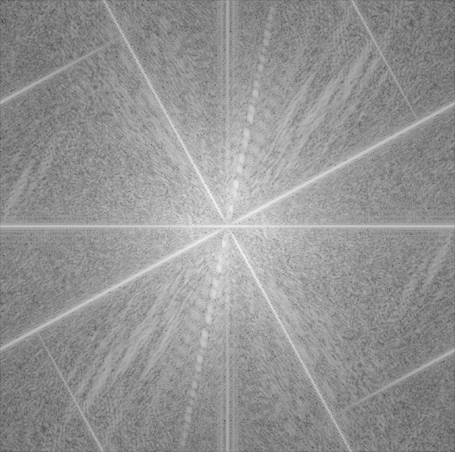 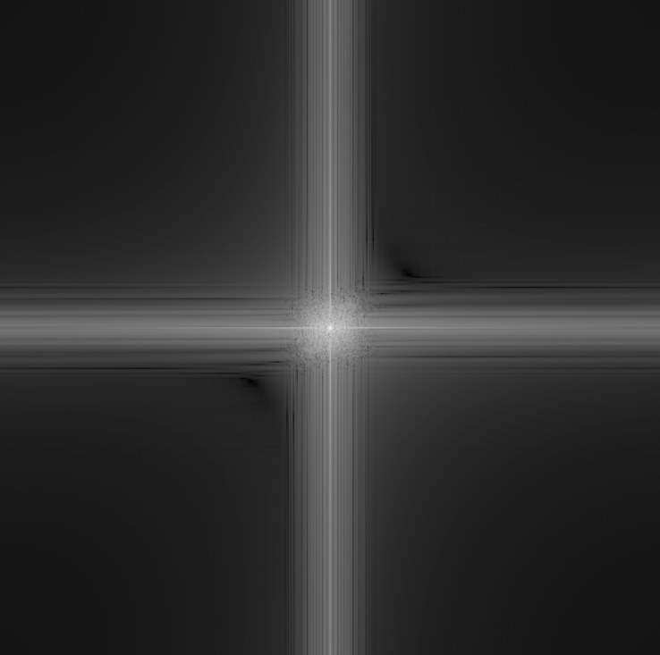 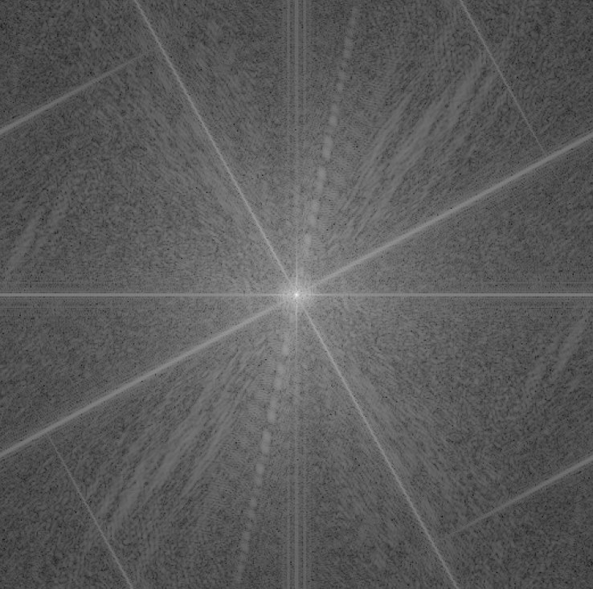

The hybrid's spectrum is literally Golik's bright core plus Nutmeg's outer ring. (The diagonal streaks in Nutmeg's spectra come from the black border that rotating the image added.)

#### Choosing the cutoffs

| Filter | σ (px) | Kernel | Half amplitude cutoff |
|---|---|---|---|
| Low pass on Golik | 7 | 43 × 43 | ≈ 0.027 cycles/px |
| High pass on Nutmeg | 4 | 25 × 25 | ≈ 0.047 cycles/px |

For this pair I picked the two cutoffs separately. σ = 7 keeps Golik's face shape and beanie, enough to read from far away without competing with the cat up close. σ = 4 adds only Nutmeg's sharpest detail (fur, whiskers, eye outlines), which is exactly what disappears first when you step back. That leaves a gap from about 0.027 to 0.047 cycles/px where neither image contributes much. The paper recommends keeping that gap small, so this is what I'd tune next. (The other two hybrids use σ = 13 for both.)

#### Try it: step back from the screen

<div class="distance" data-images="Nutmeg × Golik=media/part2/cat_high_pass_filter_golikpistachio_low_pass_filter.jpg|Nutmeg × Derek=media/part2/cat_high_pass_filter_derek_low_pass_filter.jpg|Race × Golik=media/part2/race_high_pass_filter_golik_low_pass_filter.jpg" data-caption="Shrinking the image does the same thing as walking away: the high frequencies get packed into too few pixels for your eye to resolve, so only the low pass image is left."></div>

#### Derek × Nutmeg

") ") 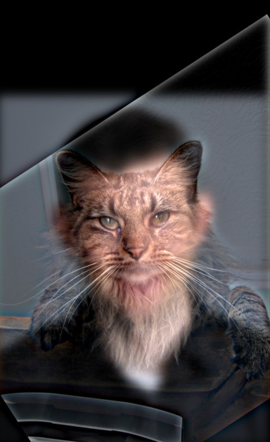

#### Race × Golik

") ") 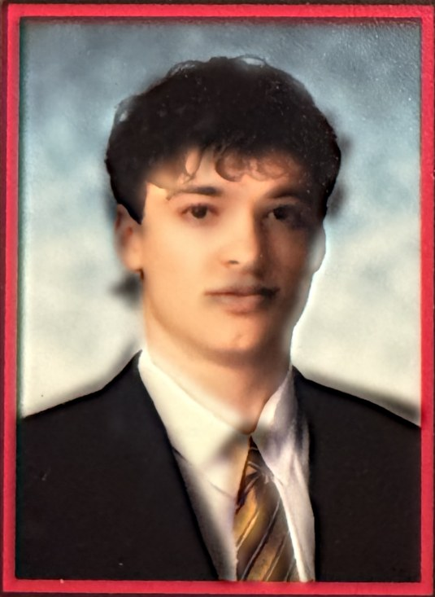

### 2.3 Stacks split an image into bands

A stack is a pyramid without the downsampling. Each Gaussian level blurs the one before it, and each Laplacian level is the difference between two neighbouring Gaussian levels, so it holds a single band of frequencies. Keeping the last Gaussian level as the final Laplacian level makes the stack add back up to the original image exactly.

<details><summary>Code</summary>

```python
def GaussianStack(image, levels=8):
    stack = []
    for level in range(levels):
        stack.append(image)
        image = blur(image)                       # 19x19, σ = 3, no downsample
    return stack

def LaplacianStack(image, levels=8):
    g = GaussianStack(image, levels)
    stack = [g[i] - g[i+1] for i in range(levels-1)]
    stack.append(g[-1])                           # keep the last blur so the sum is exact
    return stack
```

</details>

Here are all 8 levels for the apple and the orange. Laplacian levels are normalized for display, so gray means zero.

<div class="slider" data-src="media/part2/{p}_level_{v}.jpg" data-values="0,1,2,3,4,5,6,7" data-labels="level 0,level 1,level 2,level 3,level 4,level 5,level 6,level 7" data-panels="apple_gaussian,apple_laplacian,orange_gaussian,orange_laplacian" data-panel-labels="apple Gaussian,apple Laplacian,orange Gaussian,orange Laplacian"></div>

#### Figure 3.42, recreated

 to (l)")

This is Figure 3.42 from Szeliski's [*Computer Vision: Algorithms and Applications*](https://szeliski.org/Book/). Rows 1 to 3 are Laplacian levels 0, 2 and 4: the apple times the mask's Gaussian level (left), the orange times one minus it (middle), and their sum (right). The last row adds up every level.

Notice that the seam gets wider as we go down. At level 0 it's a hard line, and by level 4 the coarse colours fade into each other over a wide band. Each band gets a seam about as wide as its own features.

### 2.4 Multiresolution blending: one seam per band

Why not just blur the mask once and blend? Because any single seam width is wrong for something. A sharp seam keeps the texture crisp, but the colour jumps from apple to orange in one column. A wide seam fades the colour smoothly, but across that band you see both textures on top of each other, like a double exposure.

[Burt and Adelson](https://doi.org/10.1145/245.247)'s fix is to blend each frequency band with its own mask and add the bands back up:

$$
\text{result} = \sum_k G_k(M)\, L_k(A) + \big(1 - G_k(M)\big)\, L_k(B)
$$

<details><summary>Code</summary>

```python
for level in range(levels):
    current = MaskGaussian[level] * ALaplacian[level] + (1 - MaskGaussian[level]) * BLaplacian[level]
    total += current
total = np.clip(total, 0, 1)
```

</details>

#### The oraple

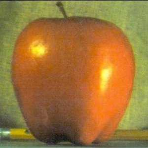 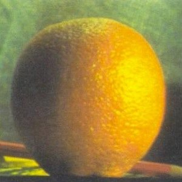 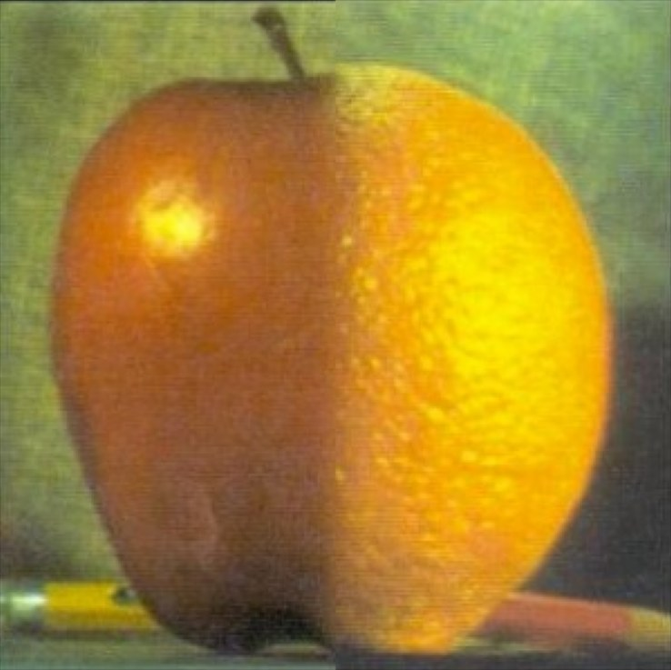

#### Golik × Race: a straight seam

 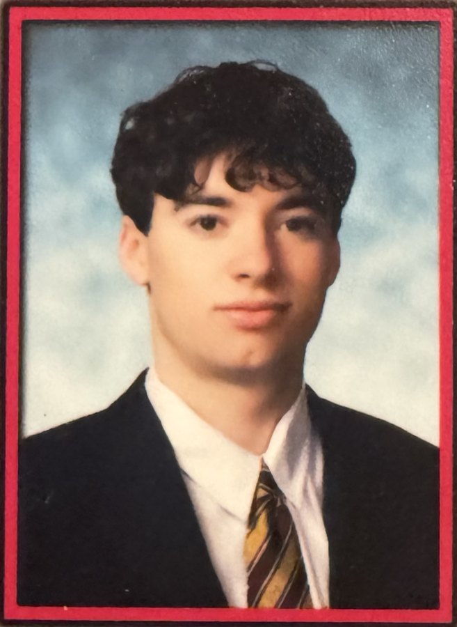 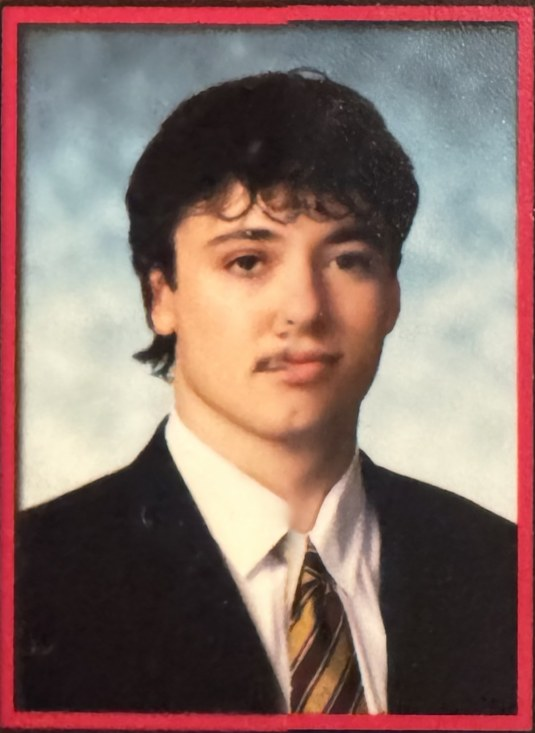

My first attempt used the oraple's 8 levels, with the seam moved to column 600 (the center of the face). It left a clear line in the skin tone down the middle of the face. Going to 40 levels fixed it.

<details><summary>Why?</summary>

The widest seam is only as wide as the mask's last Gaussian level is blurry. Blurring with σ = 3 over and over gives a total blur of $3\sqrt{k}$ after $k$ blurs, so 8 levels (7 blurs) only reaches σ ≈ 8 pixels. That's enough for the apple, but these photos are about 4x wider, so an 8 pixel fade is still a hard line relative to the face. 40 levels reaches σ ≈ 19 pixels, so the lowest band, which carries the skin tone, fades over a much wider region.

</details>

#### Nutmeg on my face: an irregular mask

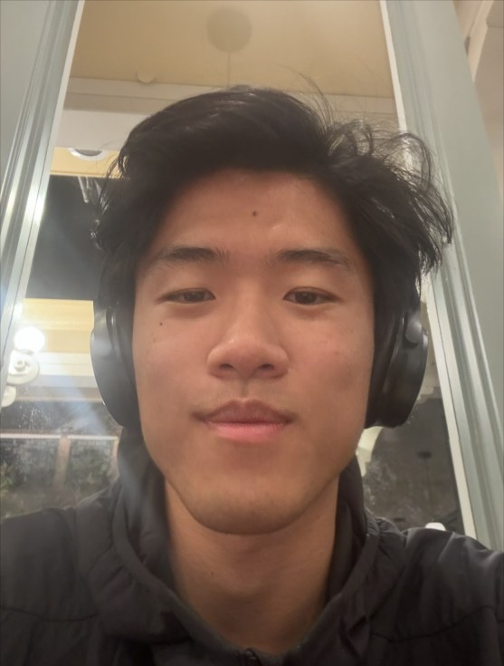 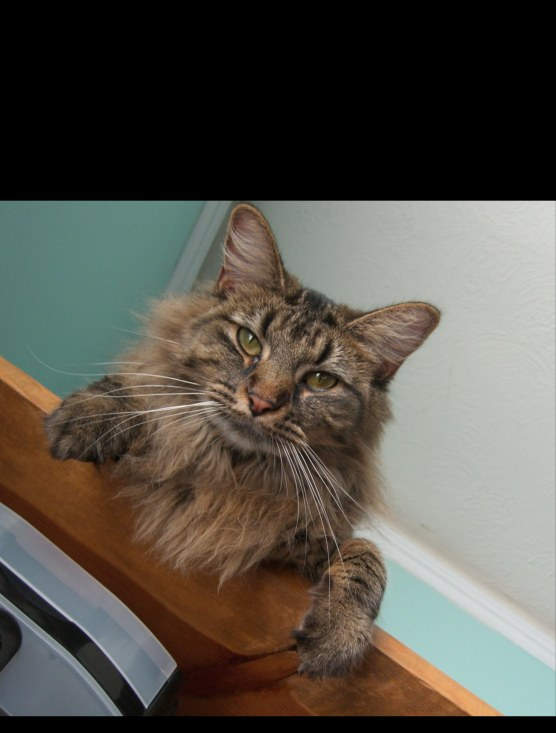 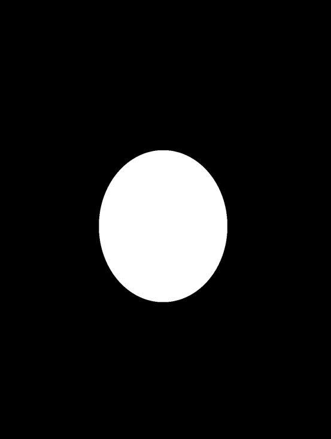 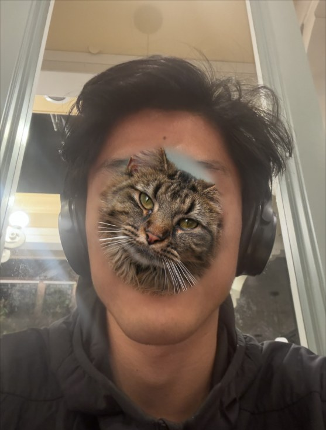

I found the center of each face by eye, (563, 780) in the selfie and (654, 362) in the cat photo, and shifted Nutmeg so the two match. The mask is an ellipse around my face. Because the mask gets blurrier at every level, the fur fades into my hair and skin instead of looking like a cut-out oval.

<div class="compare" data-left="media/part2/selfie_original.jpg" data-right="media/part2/nutmeg_s_face_blended_onto_the_selfie_elliptical_mask.jpg" data-left-label="before" data-right-label="after" data-caption="before / after (drag)"></div>

## Closing thoughts

In this project, I treated an image as a sum of frequency bands. I'd like to end with a few thoughts on where this view gets used, and where it breaks.

1. **Multiband blending is everywhere.** [Panorama stitching](https://doi.org/10.1007/s11263-006-0002-3) uses it to hide the seams between overlapping photos. [Exposure fusion](https://doi.org/10.1109/PG.2007.17) uses it to merge a dark, a normal and a bright exposure, with each pixel's mask favouring whichever exposure is best there. Google's [HDR+](https://doi.org/10.1145/2980179.2980254), one of the multi-frame photography examples from Project 1, uses a version of exposure fusion for its tone mapping.

2. **Everything here assumed we know the blur, and that it's the same everywhere.** If we know the blur, we could divide by its frequency response instead of boosting by a fixed amount. That's deconvolution, and it runs into the same wall as 2.1: dividing by a nearly-zero response multiplies the noise at those frequencies by a huge number, so practical versions like Wiener deconvolution only boost each frequency as far as the noise allows. If we don't know the blur, as with a shaky hand, both the sharp image and the kernel are unknown, and infinitely many pairs explain the same photo. Blind deconvolution picks the most likely pair using a prior on what sharp photos look like, for example that most gradients are near zero with a few large edges. [Fergus et al.](https://doi.org/10.1145/1141911.1141956) used this to remove camera shake from a single photo. And real blur often varies across the frame (camera shake, an out-of-focus background), which means estimating a different kernel for each region.

3. **Blending assumed the two images already roughly match.** Paste someone from a sunny photo into a shady one, and multiband blending will fade the colours over a wide band, but you'll still see the mismatch. [Poisson blending](https://doi.org/10.1145/882262.882269) works with gradients instead of pixel values: it keeps the pasted region's edges and texture, and solves for new pixel values that match the background exactly at the border, so the pasted region's overall colour shifts to fit its new surroundings.

## Sources

- [CS180 Project 2 description](https://cal-cs180.github.io/fa26/hw/proj2/index.html)
- Oliva, Torralba and Schyns, [Hybrid Images](https://doi.org/10.1145/1141911.1141919), SIGGRAPH 2006
- Burt and Adelson, [A Multiresolution Spline with Application to Image Mosaics](https://doi.org/10.1145/245.247), ACM Transactions on Graphics 1983
- Szeliski, [*Computer Vision: Algorithms and Applications*](https://szeliski.org/Book/)
- Canny, [A Computational Approach to Edge Detection](https://doi.org/10.1109/TPAMI.1986.4767851), IEEE TPAMI 1986
- Brown and Lowe, [Automatic Panoramic Image Stitching using Invariant Features](https://doi.org/10.1007/s11263-006-0002-3), IJCV 2007
- Mertens, Kautz and Van Reeth, [Exposure Fusion](https://doi.org/10.1109/PG.2007.17), Pacific Graphics 2007
- Hasinoff et al., [Burst Photography for High Dynamic Range and Low-Light Imaging on Mobile Cameras](https://doi.org/10.1145/2980179.2980254), SIGGRAPH Asia 2016
- Fergus et al., [Removing Camera Shake from a Single Photograph](https://doi.org/10.1145/1141911.1141956), SIGGRAPH 2006
- Pérez, Gangnet and Blake, [Poisson Image Editing](https://doi.org/10.1145/882262.882269), SIGGRAPH 2003

## Thanks

Alexei Efros

Ren Ng

Andrei Cojocaru
