<!--
  This file is the whole page. Edit text freely; images and widgets are the
  lines that start with ![ or <div class=...>. Every "TODO" paragraph shows up
  as a dashed placeholder until you replace it with your own writing.
  Cheat sheet: ../README-posts.md
-->

In this post, I'll use a large pre-trained flow model to denoise, generate and edit images (Part A), and then train a small one from scratch on MNIST (Part B). The one-line summary of flow matching is: start from pure noise, and keep nudging it in the direction a network tells you until it becomes an image.

In plain English, given some mix of image and noise at a certain time, and the thing we want to generate, the model tells us what signal to add and how much.

<details><summary>About this project</summary>

This is the third project of CS180 (Computer Vision) with Alexei Efros and Ren Ng.

Definitions:
A generative model learns to make new samples that look like they came from its training data.
In flow matching, a sample is made by starting from random noise and moving it, one small step at a time, along a learned velocity field until it becomes an image.

</details>

## The idea

Take a real image $x_1$ and a sample of pure noise $x_0 \sim \mathcal{N}(0, I)$, and draw a straight line between them. Time $t$ runs along that line, from noise at $t = 0$ to the image at $t = 1$. We train a network to predict the direction of the line from any point on it:

$$
\mathcal{L} = \big\lVert v_\theta(x_t, t, c) - (x_1 - x_0) \big\rVert^2, \qquad x_t = (1 - t)\,x_0 + t\,x_1
$$

where $c$ is whatever we condition on, like a text prompt or a class label. To generate, we start from fresh noise at $t = 0$ and follow the predicted velocity, $dx_t/dt = v_\theta(x_t, t, c)$, until $t = 1$.

That's the whole method. Everything in Part A is a different way of *using* $v_\theta$ at sampling time, and everything in Part B is about *training* it.

<details><summary>Where is this used?</summary>

Text-to-image generation, generative fill and photo editing, video and audio generation, and image restoration (denoising and super-resolution). See the end of this post for more.

</details>

## Part A: The power of flow models

All of Part A uses a pre-trained text-to-image flow model, PixNerd-XXL-P16-T2I ([Wang et al.](https://arxiv.org/abs/2507.23268)), at 512 × 512. Here the noise is written $\epsilon$:

$$
x_t = (1 - t)\,\epsilon + t\,x_1, \qquad \epsilon \sim \mathcal{N}(0, I)
$$

Unless noted otherwise: Euler step $h = 0.02$, CFG weight $w = 7$, seed 180.

### 1.1 Noisy inputs

A noisy input is just the interpolation above, with the same noise sample reused at every $t$:

 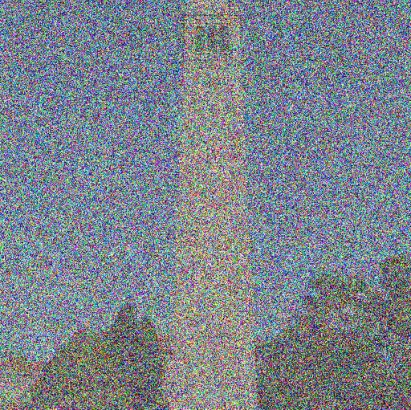 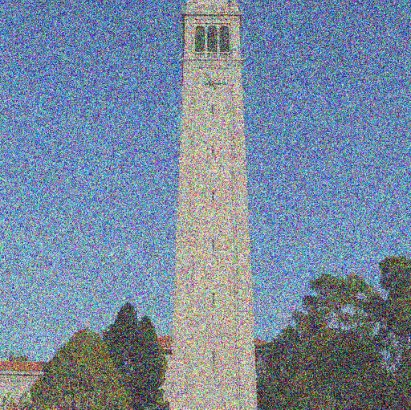 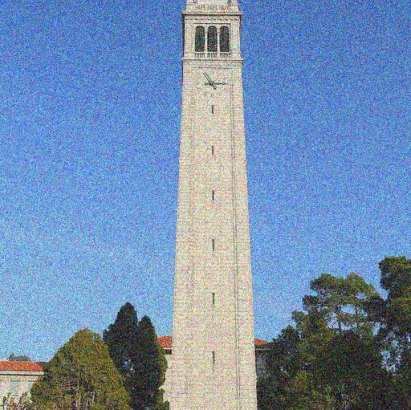

<details><summary>Code</summary>

```python
def interpolate(image, noise, t):
    return (1-t)*noise + t*image
```

</details>

### 1.2 Blurring can't tell noise from detail

As a baseline, I undo the scaling with $x_t / t$ and apply a Gaussian blur, picking the lowest-MSE σ out of {1, 2, 4, 8, 16}:

 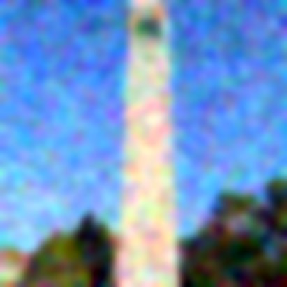  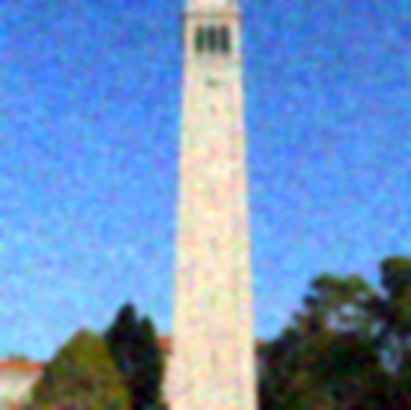

 

The best σ shrinks as $t$ grows (8, then 4, then 2), since there's less noise to average away. But even the best blur is bad. At t = 0.25 the Campanile is a smear, and at t = 0.75 the sky is still grainy. Noise and detail are both high frequency, so a Gaussian removes both (Project 2's sharpening problem, in reverse).

### 1.3 One step is much better, but it's an average

One velocity prediction with the prompt "a high quality photo" gives an estimate of the clean image:

$$
\hat{x}_1 = x_t + (1 - t)\, v_\theta(x_t, t, c)
$$

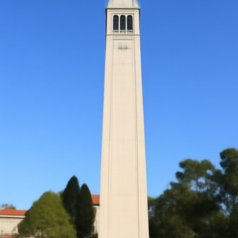  

At t = 0.75 the estimate is nearly the original: windows, clock and trees are all there. At t = 0.25 the layout is right (a white tower against blue sky with trees), but the clock and the stonework are gone and the tower is a smooth column. With that much noise, many clean images are consistent with the input, and one step can only return something like their average. This idea will come back a few times.

<details><summary>Code</summary>

```python
def one_step_denoise(x, t, condition, predict_velocity):
    return x + (1-t)*predict_velocity(x,t,condition)
```

</details>

### 1.4 Visualizing velocity

v̂ · ground truth (1−t)v_gt · error (RGB RMS)")

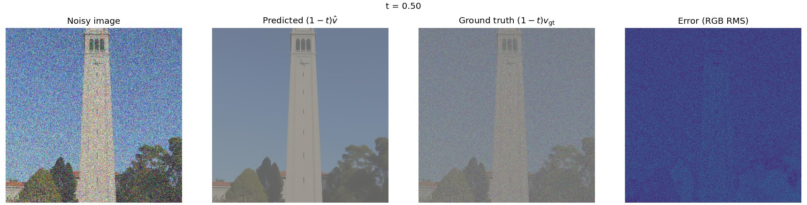

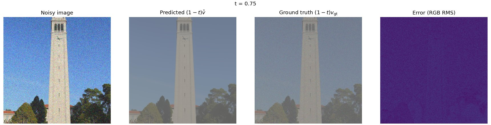

### 1.5 Lower MSE doesn't mean a better denoiser

Instead of jumping straight to $t = 1$, we can take 25 small Euler steps from the $t = 0.5$ input:

$$
x_{t+h} = x_t + h\, v(x_t, t)
$$

<div class="slider" data-src="media/a/traj_{v}.jpg" data-values="50,60,70,80,90,100" data-labels="t = 0.50,t = 0.60,t = 0.70,t = 0.80,t = 0.90,t = 1.00" data-caption="Euler trajectory, every fifth step"></div>

Here's how the three denoisers compare on the same input:

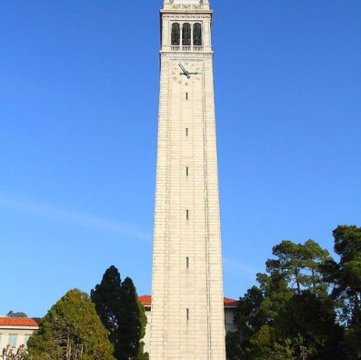   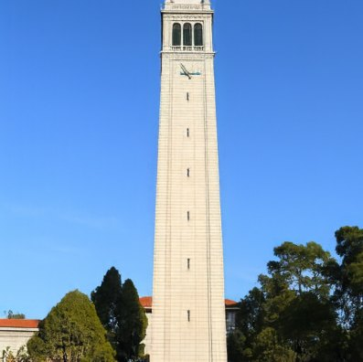

Blur is clearly the worst. But surprisingly, one step has a lower MSE than 25 Euler steps (0.0084 vs. 0.0099), even though the Euler result looks at least as sharp.

<details><summary>Why?</summary>

MSE rewards playing it safe. A single step predicts roughly the average of every clean image consistent with the input, and the average is never too far from the truth. Euler commits to one specific image as it goes, so it adds believable detail that isn't exactly what's in the original, and MSE penalizes every pixel of it.

</details>

<details><summary>Code</summary>

```python
@torch.inference_mode()
def euler_sample(x_start, t_start, step_size, velocity):
    x, t, states = x_start, t_start, [(t_start, x_start)]
    n = 0
    epsilon = 1e-6
    while t < 1 - epsilon:
        h = min(step_size, 1 - t)       # last step shrinks to land on 1
        x = x + h * velocity(x, t)
        t = round(t + h, 6)             # avoids 0.9999999 float drift
        n += 1
        if n % 5 == 0 or t == 1:
            states.append((t, x))
    return x, states
```

</details>

### 1.6 Generating from pure noise

Starting from $t = 0$ with "a high quality photo" and 50 Euler steps:

 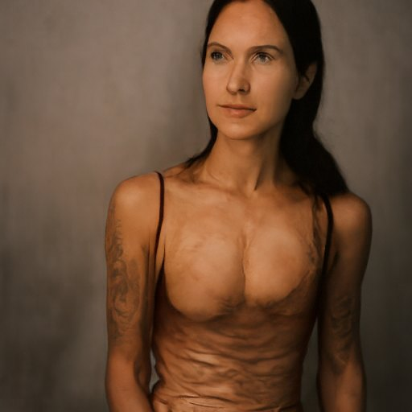 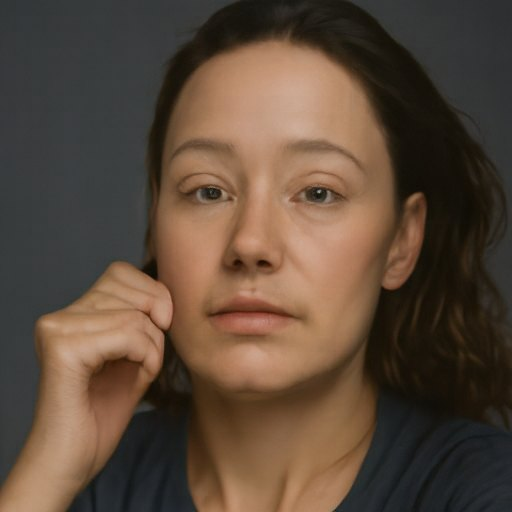 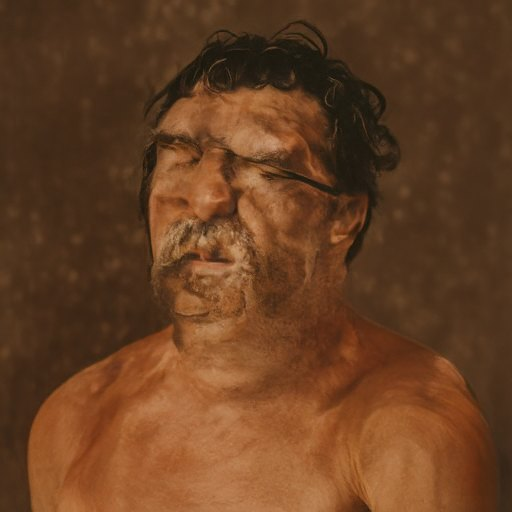 

All five seeds came out as portraits, of mixed quality. Seeds 182 and 184 are believable, but seed 180's face is missing, 181's torso is melted and 183's face is distorted. Without guidance the prompt only nudges the sample, so the model is free to wander.

### 2.1 Guidance makes samples better, and more alike

Classifier-free guidance pushes each step further in the direction the prompt changes the velocity:

$$
v_{\text{cfg}} = v_c + w\,(v_c - v_u), \qquad w = 7
$$

where $v_u$ comes from the empty prompt. Here are the same five seeds:

<div class="compare" data-left="media/a/cond_{set}.jpg" data-right="media/a/cfg_{set}.jpg" data-left-label="w = 0" data-right-label="w = 7" data-sets="seed 180=0|seed 181=1|seed 182=2|seed 183=3|seed 184=4" data-caption="drag to compare"></div>

 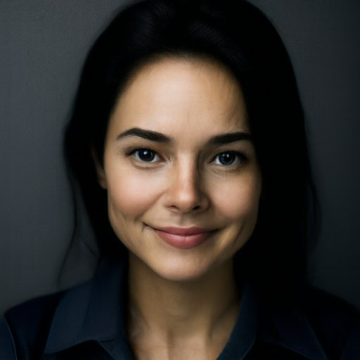 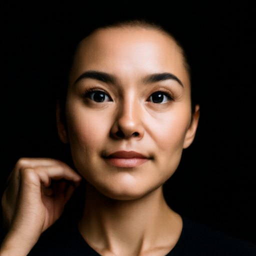  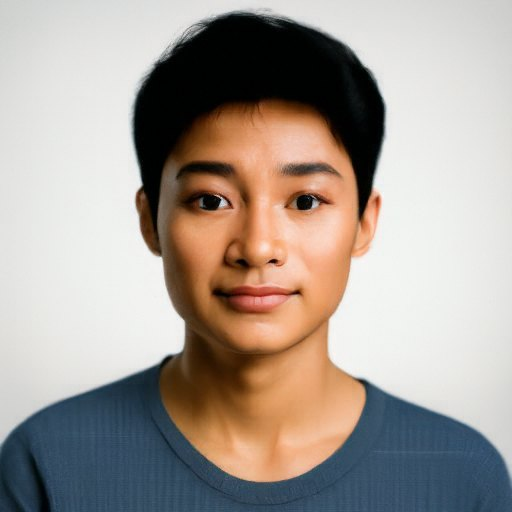

Every seed turns into a clean, well-lit studio headshot, and the distortions are gone. Some composition survives (seed 182 keeps the hand on the cheek). The cost is variety: the w = 0 samples had different poses and backgrounds, while these look like one photoshoot. Guidance pulls samples towards the most typical version of the prompt.

<details><summary>Code</summary>

```python
def cfg_velocity(x, t, condition, w, predict_velocity, null_condition=''):
    v_c = predict_velocity(x,t,condition)
    v_u = predict_velocity(x,t,null_condition)
    return v_c + w*(v_c - v_u)
```

</details>

### 3.1 Editing: how much noise to add

[SDEdit](https://arxiv.org/abs/2108.01073)'s idea is to start from a real image instead of pure noise. We noise the image to some $t_0$ and integrate from there to 1. Since $t = 0$ is pure noise, a small $t_0$ means a big edit:

<div class="slider" data-src="media/a/{set}_{v}.jpg" data-values="orig,02,04,06,10,14,25,50" data-labels="original,t₀ = 0.02,t₀ = 0.04,t₀ = 0.06,t₀ = 0.10,t₀ = 0.14,t₀ = 0.25,t₀ = 0.50" data-sets="Campanile=edit_campanile|Web image=edit_web|Drawing 1=edit_drawing1|Drawing 2=edit_drawing2" data-start="1" data-caption="prompt: “a high quality photo”"></div>

On the Campanile, $t_0$ = 0.02 is a made-up white column. From 0.04 to 0.14 it's a plain obelisk in a park, with the right layout but no belfry or clock. The belfry comes back at 0.25, and 0.50 is essentially the original. The coarse layout survives far more noise than the detail, since noise drowns out the high frequencies first.

The drawings are stranger, because "a high quality photo" pulls them towards realism:

- **Web image (a cartoon bird in a party hat):** a photo of a man at 0.02, a teardrop outline at 0.04 and 0.06, a ghostly bird with a face at 0.10, and the original drawing from 0.14 on.
- **Drawing 1 (a robin):** a black tablet at 0.02, a computer monitor at 0.04, and a woman's face inside the robin's outline at 0.06. At 0.10 the body becomes a cartoon man's face, at 0.14 it's the robin with a human-ish nose, and from 0.25 on it's the robin.
- **Drawing 2 (a sunflower with a smiley face):** a bowl of soup at 0.02, and then a realistic sunflower at 0.04, the closest any of these got to turning a drawing into a photo. From 0.06 to 0.14 the smiley face becomes a tomato-like centre, and by 0.50 it's the original.

The robin's black outline is the most stubborn feature of any image here. It's high contrast and large, so it survives a lot of noise, and the model ends up building other things inside it.

<details><summary>Code</summary>

```python
def edit(image, noise, t_start, condition, predict_velocity, w=7, step_size=0.02):
    x = interpolate(image, noise, t_start)
    v = lambda x, t: cfg_velocity(x, t, condition, w, predict_velocity)
    return euler_sample(x, t_start, step_size, v)[0]
```

</details>

### 3.2 Text-guided editing: the shape decides

Same idea, with my own prompts. At a small $t_0$ the prompt wins, and at a large one the image wins:

<div class="slider" data-src="media/a/{set}_{v}.jpg" data-values="orig,02,04,06,10,14,25,50" data-labels="original,t₀ = 0.02,t₀ = 0.04,t₀ = 0.06,t₀ = 0.10,t₀ = 0.14,t₀ = 0.25,t₀ = 0.50" data-sets="“A rocket on a launch pad”=text_campanile|“Donald Trump”=text_tower2|“Zombie Sunflower”=text_chick" data-start="1"></div>

- **Campanile → "A rocket on a launch pad":** a white rocket by a launch tower all the way to 0.14, and a dark launch structure still behind the trees at 0.25. A tall white tower is already close to a rocket, so the model only has to change details.
- **Campanile → "Donald Trump":** an older man in a suit and red tie at 0.02 and 0.04, then a plain tower from 0.06 on. A person doesn't fit the tower's shape, so the prompt loses as soon as the original has any say.
- **Chick → "Zombie Sunflower":** a proper zombie sunflower at 0.02 and 0.04. From 0.06 to 0.14 the zombie gets folded into the chick's round body, and from 0.25 on it's the chick again.

So how long a prompt survives depends on how well the image's shape already fits it.

### 3.3 Visual anagrams

The idea is simple: at every step, denoise the image upright towards prompt $a$ and upside down towards prompt $b$, and average the two ([Geng et al.](https://arxiv.org/abs/2311.17919)). With $F$ a 180° rotation:

$$
v = \tfrac{1}{2}\left[\, v_{\text{cfg}}(x, t, c_a) + F\big(v_{\text{cfg}}(F(x), t, c_b)\big) \right]
$$

<div class="flip" data-src="media/a/anagram_0.jpg" data-up="an oil painting of an old man" data-down="an oil painting of people around a campfire"></div>

<div class="flip" data-src="media/a/anagram_1.jpg" data-up="a lithograph of a snowy mountain village" data-down="a lithograph of a horse"></div>

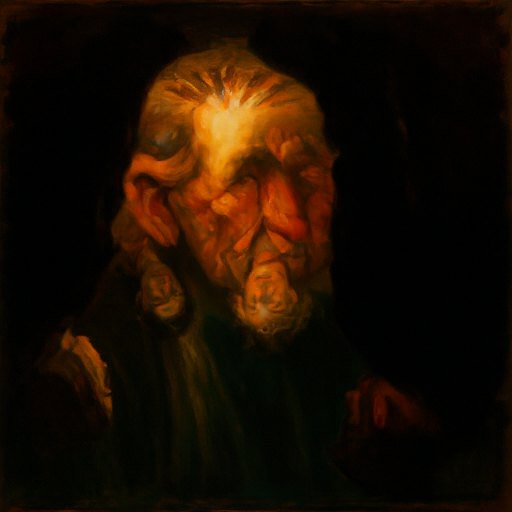 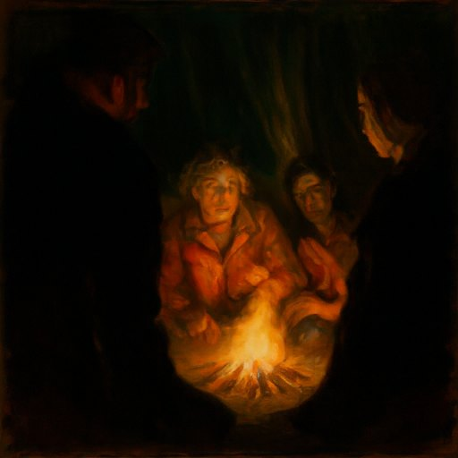 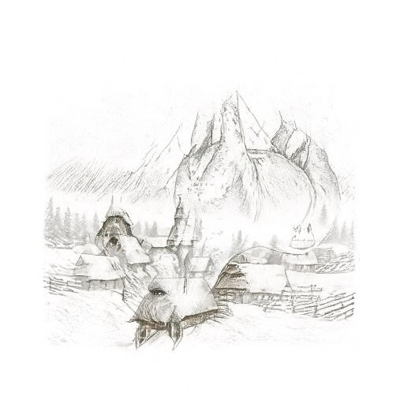 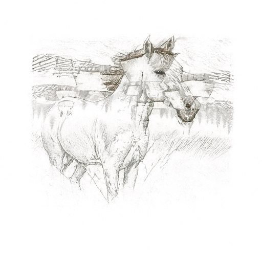

- **Old man / people around a campfire:** this works really well both ways. The old man's face, lit from below, becomes the glow of a campfire when flipped. Both prompts suit a dark painting with one bright area, which helps a lot.
- **Snowy mountain village / horse:** this one is weaker. The rotated horse is clear, but upright you can still make out parts of the upside-down horse among the houses. A horse is one big object while a village is spread across the frame, so it's harder to hide one inside the other.

<details><summary>Code</summary>

```python
def visual_anagrams(noise, condition_a, condition_b, predict_velocity, w=7, step_size=0.02):
    v_1 = lambda x, t: cfg_velocity(x, t, condition_a, w, predict_velocity)
    v_2 = lambda x, t: rotate180(cfg_velocity(rotate180(x), t, condition_b, w, predict_velocity))
    v = lambda x,t: (v_1(x,t) + v_2(x,t)) / 2
    return euler_sample(noise, 0, step_size, v)[0]
```

</details>

### 3.4 Hybrid images, inside the sampler

These are Project 2's hybrid images, except instead of filtering two finished images, we filter the two velocities at every step ([Geng et al.](https://arxiv.org/abs/2404.11615)):

$$
v = \mathrm{lowpass}(v_a) + v_b - \mathrm{lowpass}(v_b)
$$

The low pass is a Gaussian with σ = 16 (kernel 265). Prompt $a$ is what you see from far away, and prompt $b$ is what you see up close.

<div class="distance" data-images="Skull × waterfall=media/a/hybrid_0.jpg|Cat × forest=media/a/hybrid_1.jpg" data-caption="drag left to step back · far: “a lithograph of a skull” / “a lithograph of a cat” · close: “a lithograph of a waterfall” / “a lithograph of a forest”"></div>

Up close both work: a clear waterfall over a cliff, and a clear forest of tall trees. From far away they're weaker than I'd like. The skull and the cat are only faint overall shapes, and you mostly see them if you know to look. A larger σ, or prompt pairs with more similar layouts, would probably help.

<details><summary>Code</summary>

```python
def make_hybrids(noise, condition_a, condition_b, predict_velocity, w=7, step_size=0.02):
    v_1 = lambda x, t: cfg_velocity(x, t, condition_a, w, predict_velocity)
    v_2 = lambda x, t: cfg_velocity(x, t, condition_b, w, predict_velocity)
    v = lambda x,t: (lowpass(v_1(x,t)) + v_2(x,t) - lowpass(v_2(x,t)))
    return euler_sample(noise, 0, step_size, v)[0]
```

</details>

## Part B: Flow matching from scratch

In Part A the velocity field came pre-trained. Here I train one from scratch on MNIST: first as a one-step denoiser, and then as a flow model that generates digits, with and without a class label.

### 1.1 The UNet

The network is a small [UNet](https://arxiv.org/abs/1505.04597). It takes the 28 × 28 image down twice (28 → 14 → 7), squeezes the 7 × 7 map into a single vector, and brings it back up to full size. On the way up, each level is concatenated with its match from the way down, so the detail that downsampling threw away is still available at the end. $D$ sets the number of channels.

<details><summary>Code</summary>

```python
def forward(self, x):
    h1 = self.convblock_1(x)
    h2 = self.downblock_1(h1)
    h3 = self.downblock_2(h2)
    h5 = self.unflatten(self.flatten(h3))
    h7 = self.upblock_1(torch.cat([h3, h5], dim=1))
    h9 = self.upblock_2(torch.cat([h2, h7], dim=1))
    h11 = self.convblock_2(torch.cat([h1, h9], dim=1))
    return self.final(h11)
```

</details>

### 1.2 A single-step denoiser

We add noise to a digit and train the UNet to remove it:

$$
z = x + \sigma\epsilon, \qquad L = \lVert D_\theta(z) - x \rVert^2
$$

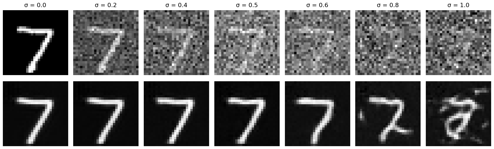

As σ grows, the digit fades. The 7 is obvious at 0.2, readable at 0.5 and hard to see at 0.8. At 1.0 the noise is as strong as the brightest pixel in the digit, and there's almost nothing left.

#### Training at σ = 0.5

D = 128, batch 256, Adam with learning rate 1e-4, 5 epochs (1175 steps).

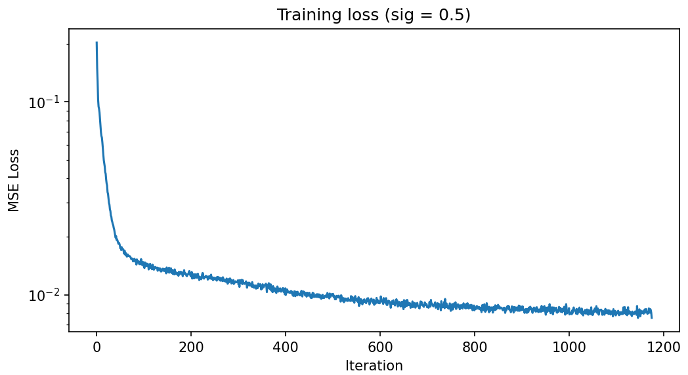

Test digits at σ = 0.5, with the same digits and noise after each epoch:

, denoised")

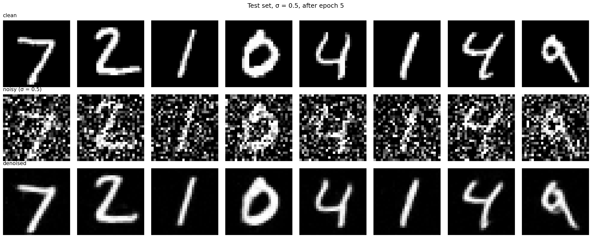

The loss falls from about 0.2 to 0.015 in the first ~100 iterations, then creeps down to about 0.008. After 1 epoch the digits are readable but blotchy (look at the 4s and the 2). After 5 they're smooth and very close to the originals.

#### Out-of-distribution σ

The bottom row of the first figure runs the σ = 0.5 model on the same 7 at every σ from 0 to 1. Up to 0.6, every output is a clean 7, since less noise is just an easier version of the same problem. Above that it breaks: σ = 0.8 gives something closer to a 2, and σ = 1.0 gives a scribble. The model has learned how much noise to expect, so it mistakes the extra noise for strokes.

#### Denoising pure noise gives the average digit

What happens if the input has no digit in it at all, $z \sim \mathcal{N}(0, I)$?

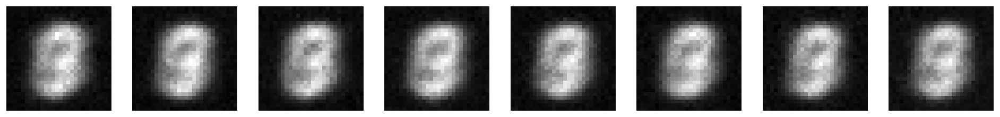

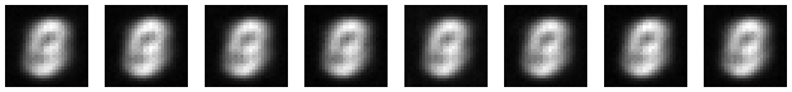

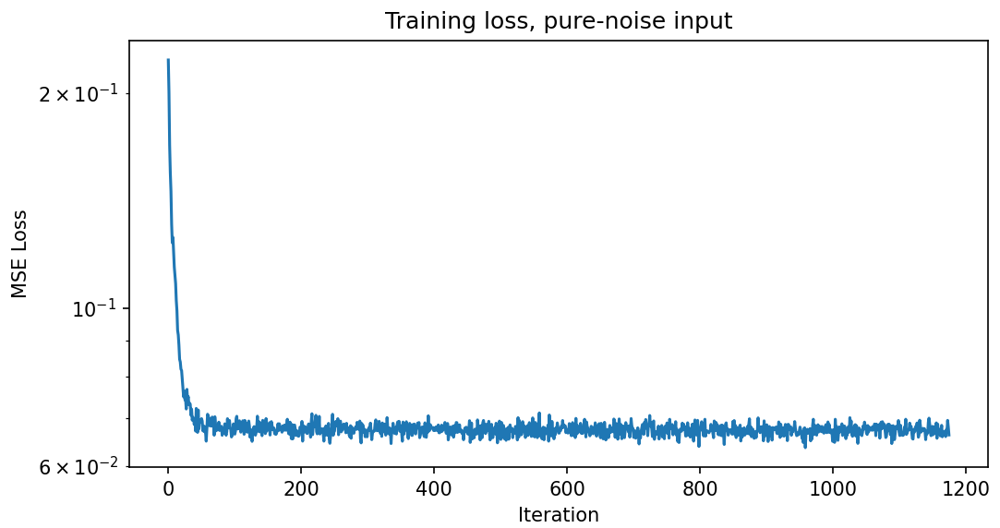

Every output is the same blurry blob, like all the digits stacked on top of each other, with hints of a 0, a 3 and an 8. After 5 epochs the outputs are even more alike, and the loss levels off at about 0.07.

This comes straight from the loss. With MSE, the best possible prediction for an input $z$ is the average of all the clean images that could have produced it:

$$
D^*(z) = \mathbb{E}[\,x \mid z\,]
$$

Pure noise tells us nothing about $x$, so the best the model can do is predict the same thing every time: the average of the whole training set, $\mathbb{E}[x]$. That's the blob, the centroid of all the digits. The loss can't go below the spread of the digits around that average, which is why it plateaus.

This is the one-step averaging from 1.3, taken to the extreme. It's also why flow matching takes many small steps from noise instead of one big one.

### 2.1 Time conditioning

From here on, the UNet predicts the flow matching velocity instead of a clean digit:

$$
x_t = (1 - t)\,x_0 + t\,x_1, \qquad u = x_1 - x_0, \qquad L = \lVert u_\theta(x_t, t) - u \rVert^2
$$

The right velocity at t = 0.1 is very different from the right velocity at t = 0.9, so the network needs to know $t$. Two small fully connected blocks (FCBlocks: linear, GELU, linear) turn $t$ into one number per channel, which multiplies the feature maps in two places: right after the bottleneck, and after the first upsampling block.

<details><summary>Code</summary>

```python
class FCBlock(nn.Module):
    def __init__(self, in_channels, out_channels):
        super().__init__()
        self.fc1 = nn.Linear(in_channels, out_channels)
        self.act = nn.GELU()
        self.fc2 = nn.Linear(out_channels, out_channels)

    def forward(self, x):
        return self.fc2(self.act(self.fc1(x)))

# TimeConditionalUNet.forward
t  = t.view(-1,1).float()
t1 = self.fcblock(t)[:, :, None, None]
t2 = self.fcblock_2(t)[:, :, None, None]
h1 = self.convblock_1(x)
h2 = self.downblock_1(h1)
h3 = self.downblock_2(h2)
h5 = self.unflatten(self.flatten(h3)) * t1
h7 = self.upblock_1(torch.cat([h3, h5], dim=1)) * t2
h9 = self.upblock_2(torch.cat([h2, h7], dim=1))
h11 = self.convblock_2(torch.cat([h1, h9], dim=1))
return self.final(h11)
```

</details>

### 2.2 Training

D = 64, batch 64, Adam starting at 1e-2 with ExponentialLR ($\gamma = 0.1^{1/10}$, so the learning rate drops about 10x overall), 10 epochs (9380 steps).

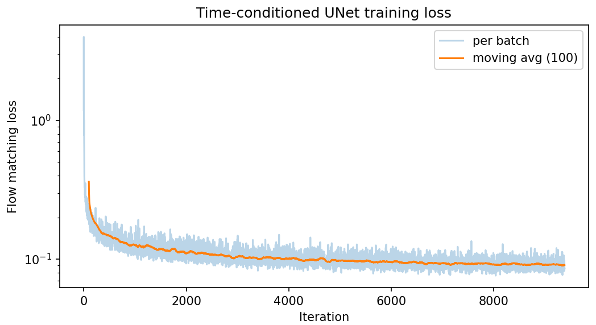

The loss falls fast in the first few hundred steps, flattens out around 0.1, and slowly creeps down from there. The per-batch loss stays noisy the whole time, because every batch uses different random times, and some are much harder than others: near $t = 0$ the network has to guess the whole digit.

### 2.3 Sampling

40 samples (seeds 0–39), 50 Euler steps.

<div class="slider" data-src="media/b/tc_epoch{v}.png" data-values="1,5,10" data-labels="epoch 1,epoch 5,epoch 10" data-start="2"></div>

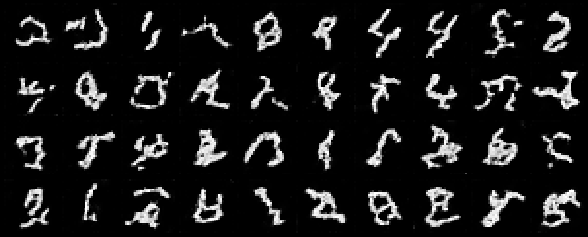 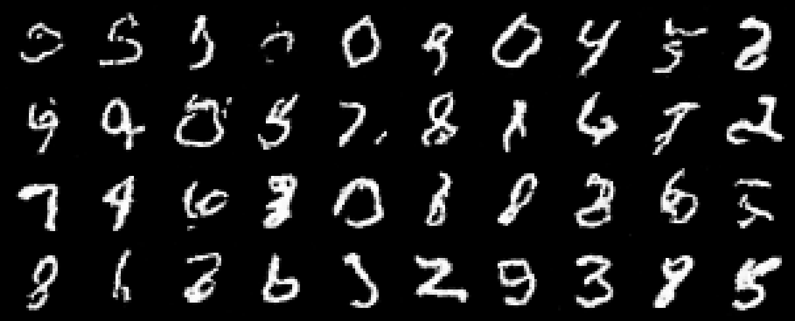 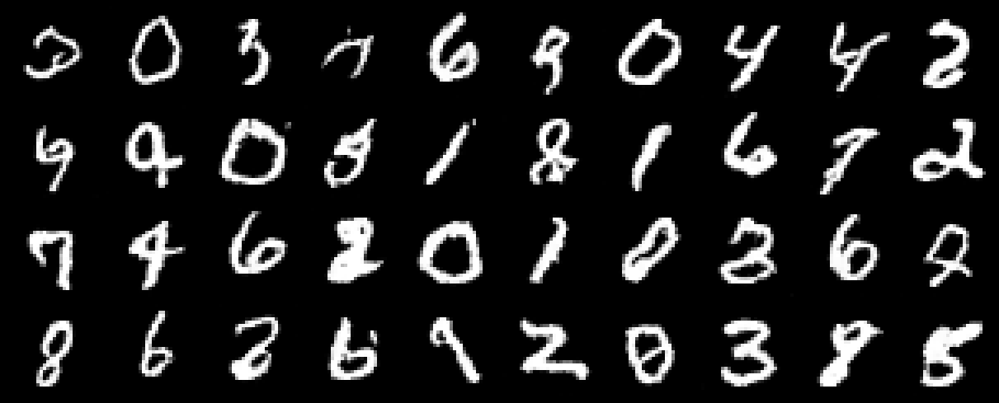

After 1 epoch the samples are digit-like scribbles: right stroke width, white on black, but mostly not digits. After 5, most are recognizable, with some broken strokes. After 10, most are clean and legible. Since there's no class label, we can't choose which digit we get, and a few land somewhere in between two digits.

<details><summary>Code</summary>

```python
def time_fm_forward(unet, x_1, num_ts):
    N = x_1.shape[0]
    x_0 = torch.randn_like(x_1)
    t = torch.rand(N, device = x_1.device)
    t_b = t[:, None, None, None]
    x_t = (1-t_b) * x_0 + t_b * x_1
    u_true = x_1-x_0
    u_pred = unet(x_t, t)
    return F.mse_loss(u_pred, u_true)

# sampling: Euler from t = 0 to 1
x = torch.randn(num_samples, 1, H, W, device = device)
dt = 1.0/num_ts
for i in range(num_ts):
    t = torch.full((num_samples,), i*dt, device=device)
    x = x + dt * unet(x,t)
```

</details>

### 2.4 Class conditioning

To choose which digit we get, we also feed in the class as a one-hot vector $c$. Two more FCBlocks turn $c$ into per-channel scales, so at the same two places as before, the class scales the feature map and the time shifts it:

$$
\text{unflatten} \leftarrow c_1 \cdot \text{unflatten} + t_1, \qquad \text{up}_1 \leftarrow c_2 \cdot \text{up}_1 + t_2
$$

10% of the time, $c$ is set to all zeros, so the same network also learns the unconditional velocity. That's what lets us use classifier-free guidance, just like in Part A: $v_u$ comes from the zero class and $v_c$ from the real one.

<details><summary>Code</summary>

```python
c = F.one_hot(c, num_classes=10).float()
if mask is not None:
    c = c * mask.view(-1, 1).float()
t1 = self.fcblock(t)[:, :, None, None]
t1_class = self.fcblock_2(c)[:, :, None, None]
t2 = self.fcblock_3(t)[:, :, None, None]
t2_class = self.fcblock_4(c)[:, :, None, None]
...
h5 = (self.unflatten(self.flatten(h3)) * t1_class) + t1
h7 = (self.upblock_1(torch.cat([h3, h5], dim=1)) * t2_class) + t2

# sampling with classifier-free guidance
for i in range(num_ts):
    t = torch.full((N, ), i*dt, device=device)
    v_c = unet(x,c,t,ones)
    v_u = unet(x,c,t, zeros)
    v = v_u + guidance_scale * (v_c-v_u)
    x = x + dt * v
```

</details>

### 2.5 Training

Same hyperparameters as 2.2, plus $p_{\text{uncond}} = 0.1$.

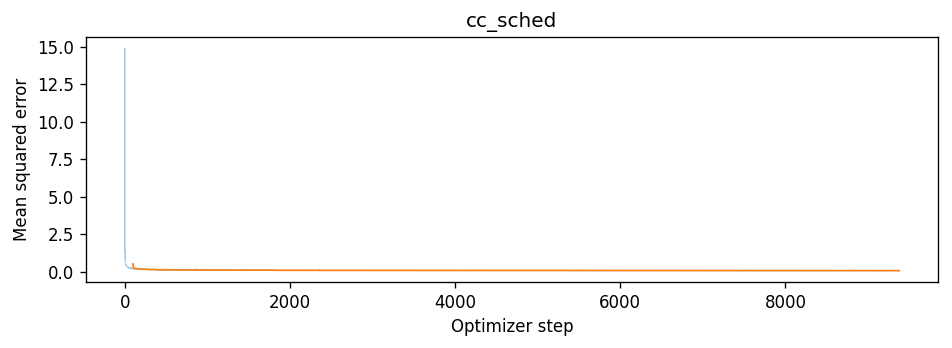

Same picture as 2.2, except the first few steps start much higher (around 15), which squashes the rest of the plot flat. After a few hundred steps it settles at about the same level as the time-only model.

### 2.6 Sampling

Four of each digit, guidance $\gamma = 5$ with $v = v_u + \gamma(v_c - v_u)$, 300 Euler steps, seed 0.

<div class="slider" data-src="media/b/cc_epoch{v}.png" data-values="1,5,10" data-labels="epoch 1,epoch 5,epoch 10" data-start="2"></div>

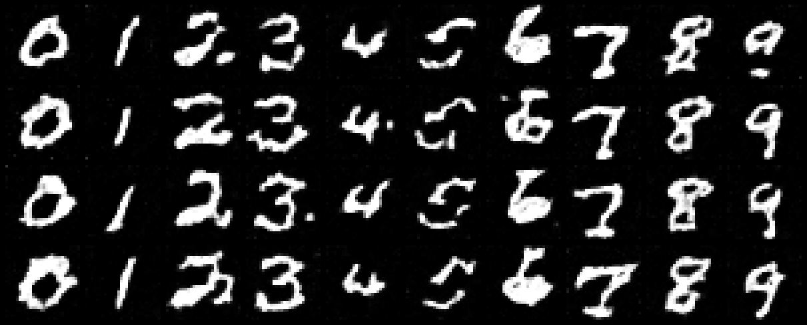 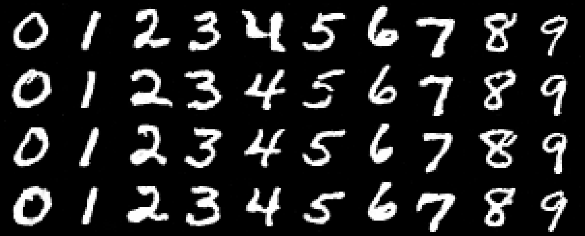 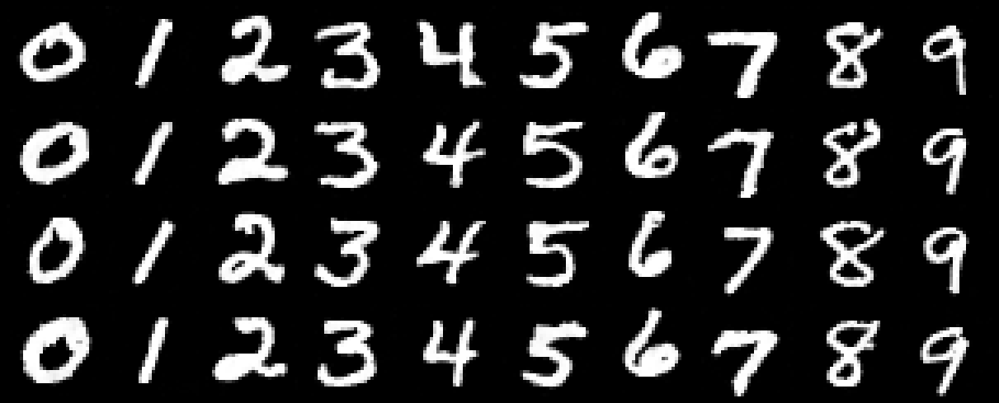

Even at epoch 1 almost every slot has the right digit, though many are rough (especially the 5s). By epoch 5 they're all clean, and epoch 10 is a little smoother still. They're also much more consistent than in 2.3, partly because we tell the model which digit to make, and partly because guidance pulls each one towards a typical example of its class.

#### Without the learning-rate scheduler

Without a scheduler, the learning rate never decays, so the weights tend to keep bouncing around the minimum instead of settling. I made two changes to make up for it:

- **A lower constant learning rate, 1e-3.** That's about where the scheduled run ends up (1e-2 decayed to about 1.3e-3), so training is stable from the start, at the cost of moving more slowly early on.
- **An exponential moving average (EMA) of the weights, with decay 0.999.** We sample from a running average of the weights instead of the latest ones. The averaging cancels out the bouncing, which is the job a decaying learning rate would normally do.

Here are the results, with the same seed and digit grid as above:

<div class="slider" data-src="media/b/cc_nosched_epoch{v}.png" data-values="1,5,10" data-labels="epoch 1,epoch 5,epoch 10" data-start="2" data-caption="no scheduler, EMA weights · same seed and digit grid as above"></div>

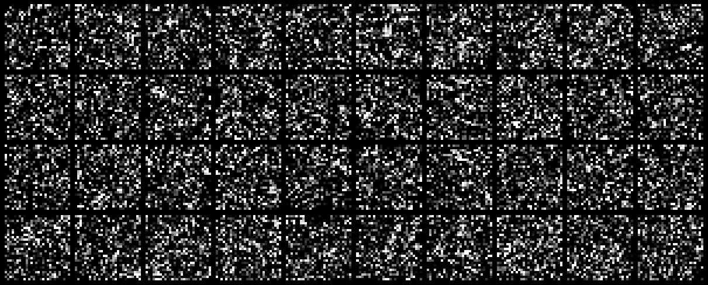 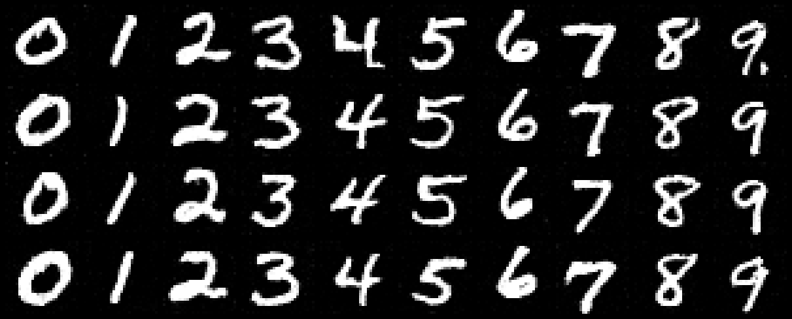 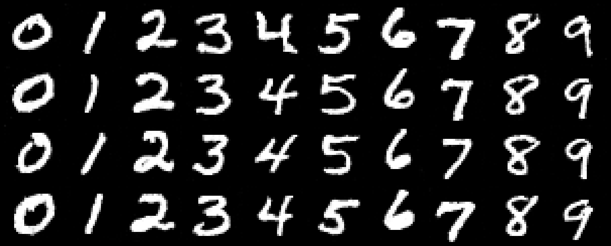

<div class="compare" data-left="media/b/cc_epoch10.png" data-right="media/b/cc_nosched_epoch10.png" data-left-label="scheduler" data-right-label="no scheduler" data-caption="epoch 10, with vs. without the scheduler (drag)"></div>

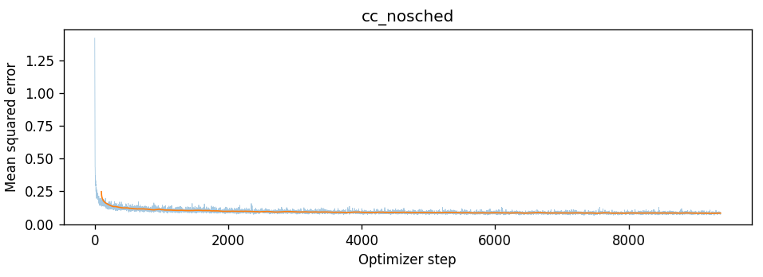

The epoch 1 samples are pure noise. That's the EMA, not the model: after one epoch (938 steps), the average still gives $0.999^{938} \approx 0.39$ of its weight to the random initial weights. By epoch 5 it has caught up, and at epochs 5 and 10 the samples are about as good as the scheduled run's. The loss levels off in about the same place, too.

<details><summary>Code</summary>

```python
from torch.optim.swa_utils import AveragedModel, get_ema_multi_avg_fn

ns_lr = 1e-3                     # constant LR (the scheduled run went 1e-2 -> ~1.3e-3)
ns_model = ClassConditionalFM(ClassConditionalUNet(1, 10, hidden_dim)).to(device)
ns_optimizer = torch.optim.Adam(ns_model.parameters(), lr=ns_lr)
ns_ema = AveragedModel(ns_model, multi_avg_fn=get_ema_multi_avg_fn(0.999),
                       use_buffers=True)   # BatchNorm stats get averaged too

for epoch in range(num_epochs):
    for images, labels in tqdm(cc_train_loader):
        images, labels = images.to(device), labels.to(device)
        loss = ns_model(images, labels)
        ns_optimizer.zero_grad()
        loss.backward()
        ns_optimizer.step()
        ns_ema.update_parameters(ns_model)
    # samples come from ns_ema.module
```

</details>

## Beyond Bells & Whistles: The Modern Research Frontier

Looking back, one pre-trained velocity field did a surprising amount of work in Part A. Without any retraining, it denoised, generated from scratch, edited photos and drawings, and made two kinds of optical illusions. All we changed was how we used the velocity: where we started, how we combined two predictions, and how we filtered them.

In my opinion, though, this project only shows a narrow slice of what flow matching can do. A few observations:
- **A: The thing we generate is an image.** Every sample was a fixed grid of pixels.
- **B: The condition is a short prompt or a class label.**
- **C: There is no time pressure.** Each image took 50 to 300 network calls, and nothing was waiting on the result.

This sparked my curiosity, because nothing in the training loss mentions pixels. $x_1$ is just a vector of numbers. Flow matching only needs lots of examples of that vector, noise of the same size, and a network that can predict a velocity. The problem is always the same: move a simple distribution (noise) onto a complicated one (the data), optionally conditioned on something. So what else can we write down as a vector?

Realistically, almost anything we have a lot of examples of. A video is a stack of images with a time axis. Audio is a waveform, or a spectrogram, which is an image of sound. A protein is a list of 3D atom positions. A weather forecast is a grid of temperatures, pressures and winds. A robot's next second of movement is a sequence of joint angles.

The last one is the most interesting to me, because of what we saw with pure noise in Part B. A model trained with plain MSE predicts the average of every answer consistent with its input, and for a robot that's dangerous. If there are two good ways around an obstacle, left or right, the average goes straight into it. A generative model doesn't average: it samples one of the good answers. This is why many robot policies now generate actions the way Part A generated images, first with diffusion ([Diffusion Policy](https://arxiv.org/abs/2303.04137)) and now with flow matching.

This leads to vision-language-action (VLA) models, which take in camera images and an instruction ("fold the shirt") and output robot actions. [Physical Intelligence's π0](https://arxiv.org/abs/2410.24164) is a good example. It starts from a vision-language model pre-trained on internet data, which understands the scene and the instruction, and attaches an "action expert" trained with flow matching. Instead of an image, the action expert generates the next 50 actions, starting from noise and integrating a velocity field, exactly like Part A. The vision-language model plays the role the text prompt played for PixNerd.

I list some of these problems below, along with their subproblems and the groups working on them. Some use diffusion rather than flow matching. The two are close cousins: with the straight-line paths from this project, they're two ways of training the same kind of model.

| Name | Explanation | Subproblems | Groups Working on It |
|---|---|---|---|
| **Text-to-image** | Generate an image from a text prompt. This is Part A at a much larger scale. | Following long, detailed prompts, rendering text inside images, fewer sampling steps | [Stability AI (Stable Diffusion 3)](https://arxiv.org/abs/2403.03206), [Black Forest Labs (FLUX)](https://bfl.ai/) |
| **Video generation** | Generate a video clip from text or an image. Every frame has to be a good image, and the frames have to agree with each other over time. | Consistency over time, believable motion and physics, compute cost (a video is hundreds of images) | [Meta (Movie Gen)](https://ai.meta.com/research/movie-gen/) |
| **Speech and audio** | Generate speech in a given voice, or fill in missing audio, from text. | Matching a voice from a few seconds of audio, editing part of a recording | [Meta (Voicebox)](https://arxiv.org/abs/2306.15687) |
| **Robot control (VLAs)** | Look at the scene, read an instruction and generate the robot's next movements. | Generalizing to new homes and objects, reacting in real time, collecting enough robot data | [Physical Intelligence (π0, π0.5)](https://www.physicalintelligence.company/), [NVIDIA (GR00T N1)](https://arxiv.org/abs/2503.14734) |
| **Protein structure and design** | Generate the 3D shape of a protein, either to predict how a known one folds or to design a new one. | Generating rotations and 3D positions, physical validity, whether designs work in a lab | [Isomorphic Labs (AlphaFold 3)](https://www.isomorphiclabs.com/), [FoldFlow](https://arxiv.org/abs/2310.02391) |
| **Weather forecasting** | Generate many possible versions of tomorrow's weather, so forecasters get probabilities instead of a single guess. | Calibrated uncertainty, rare extreme events, staying stable over long forecasts | [Google DeepMind (GenCast)](https://arxiv.org/abs/2312.15796) |

Staying within flow matching (where we still learn a velocity field that carries noise to data), here's how each of our assumptions breaks.

We can break **A** with data that doesn't live on a flat grid. A protein backbone is described by the position and the rotation of each residue, and a rotation isn't a point on a line: rotate far enough and you come back to where you started. So the straight line $x_t = (1 - t)\,x_0 + t\,x_1$ no longer makes sense. Instead we move along the shortest path on the curved space of rotations, and the velocity has to stay tangent to that space. [Flow matching on general geometries](https://arxiv.org/abs/2302.03660) does this in general, and [FoldFlow](https://arxiv.org/abs/2310.02391) applies it to protein backbones.

We can break **B** with a much richer condition. For a robot, $c$ is several camera images, the robot's own joint positions and an instruction in plain language. A small FCBlock like the one in 2.4 can't make sense of that, so VLAs use a large pre-trained vision-language model as the conditioning network. [π0.5](https://arxiv.org/abs/2504.16054) pushes this further by co-training on web data and data from many different robots, so the policy can clean a kitchen in a home it has never seen.

We can break **C** by needing the answer immediately. A robot can't stand still for 50 network calls every time it decides what to do. π0 uses only 10 Euler steps, and generates a whole chunk of actions at once, executing it while the next chunk is computed. That's enough to control a robot at up to 50 Hz. But if the new chunk disagrees with the moves already under way, the robot pauses or jerks at the boundary. [Real-time chunking](https://arxiv.org/abs/2506.07339) fixes this by freezing the actions that are already committed and generating the rest of the chunk to match. That's close to what we did in 3.1: keep part of the signal, and let the flow fill in the rest.

## Sources

- Wang et al., [PixNerd: Pixel Neural Field Diffusion](https://arxiv.org/abs/2507.23268)
- Lipman et al., [Flow Matching for Generative Modeling](https://arxiv.org/abs/2210.02747), ICLR 2023
- Ho and Salimans, [Classifier-Free Diffusion Guidance](https://arxiv.org/abs/2207.12598)
- Meng et al., [SDEdit: Guided Image Synthesis and Editing with Stochastic Differential Equations](https://arxiv.org/abs/2108.01073), ICLR 2022
- Geng, Park and Owens, [Visual Anagrams: Generating Multi-View Optical Illusions with Diffusion Models](https://arxiv.org/abs/2311.17919), CVPR 2024
- Geng, Park and Owens, [Factorized Diffusion: Perceptual Illusions by Noise Decomposition](https://arxiv.org/abs/2404.11615), ECCV 2024
- Ronneberger, Fischer and Brox, [U-Net: Convolutional Networks for Biomedical Image Segmentation](https://arxiv.org/abs/1505.04597), MICCAI 2015
- Chi et al., [Diffusion Policy: Visuomotor Policy Learning via Action Diffusion](https://arxiv.org/abs/2303.04137), RSS 2023
- Black et al., [π0: A Vision-Language-Action Flow Model for General Robot Control](https://arxiv.org/abs/2410.24164)
- Physical Intelligence, [π0.5: a Vision-Language-Action Model with Open-World Generalization](https://arxiv.org/abs/2504.16054)
- Black, Galliker and Levine, [Real-Time Execution of Action Chunking Flow Policies](https://arxiv.org/abs/2506.07339)
- NVIDIA, [GR00T N1: An Open Foundation Model for Generalist Humanoid Robots](https://arxiv.org/abs/2503.14734)
- Esser et al., [Scaling Rectified Flow Transformers for High-Resolution Image Synthesis](https://arxiv.org/abs/2403.03206), ICML 2024
- Polyak et al., [Movie Gen: A Cast of Media Foundation Models](https://arxiv.org/abs/2410.13720)
- Le et al., [Voicebox: Text-Guided Multilingual Universal Speech Generation at Scale](https://arxiv.org/abs/2306.15687), NeurIPS 2023
- Chen and Lipman, [Flow Matching on General Geometries](https://arxiv.org/abs/2302.03660), ICLR 2024
- Bose et al., [SE(3)-Stochastic Flow Matching for Protein Backbone Generation](https://arxiv.org/abs/2310.02391), ICLR 2024
- Price et al., [GenCast: Diffusion-based Ensemble Forecasting for Medium-Range Weather](https://arxiv.org/abs/2312.15796)
- [MNIST](https://pytorch.org/vision/stable/generated/torchvision.datasets.MNIST.html), via torchvision

## Thanks

Alexei Efros

Ren Ng
